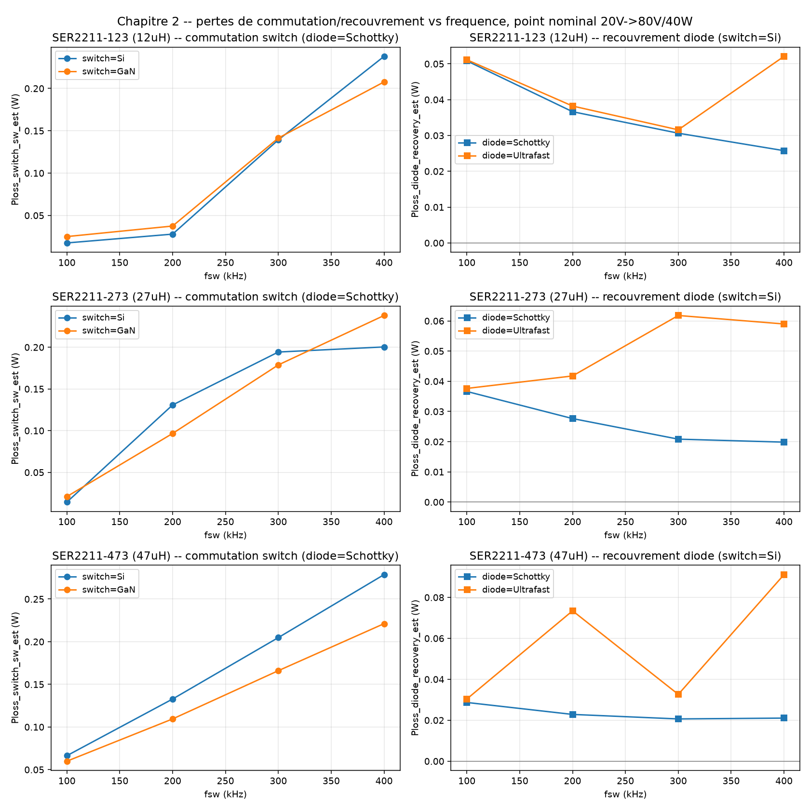
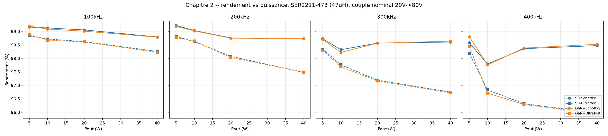
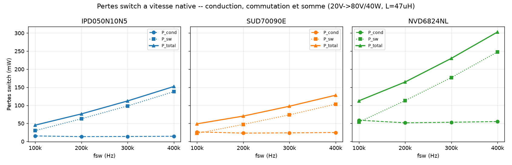
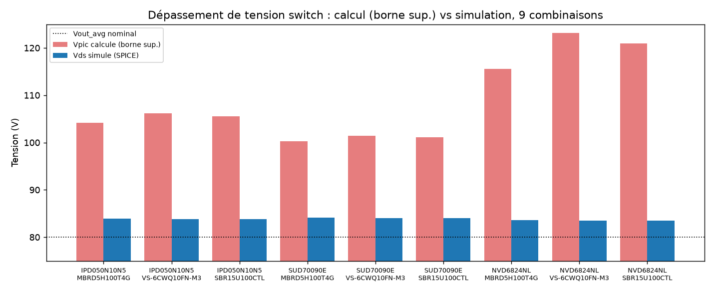
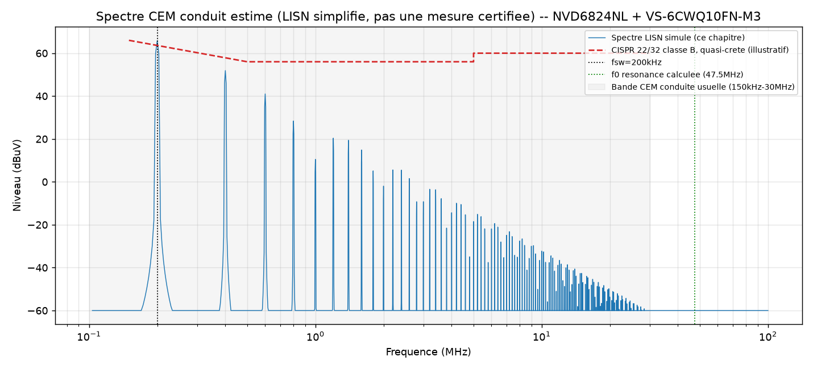
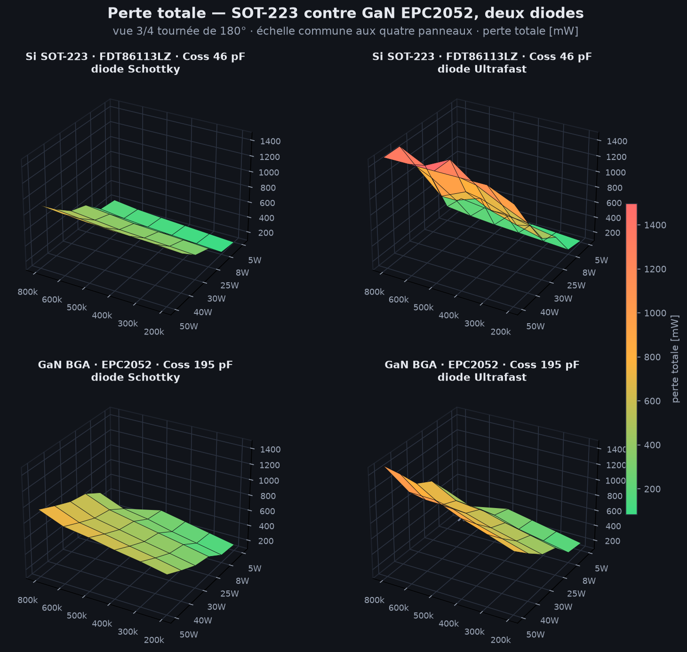
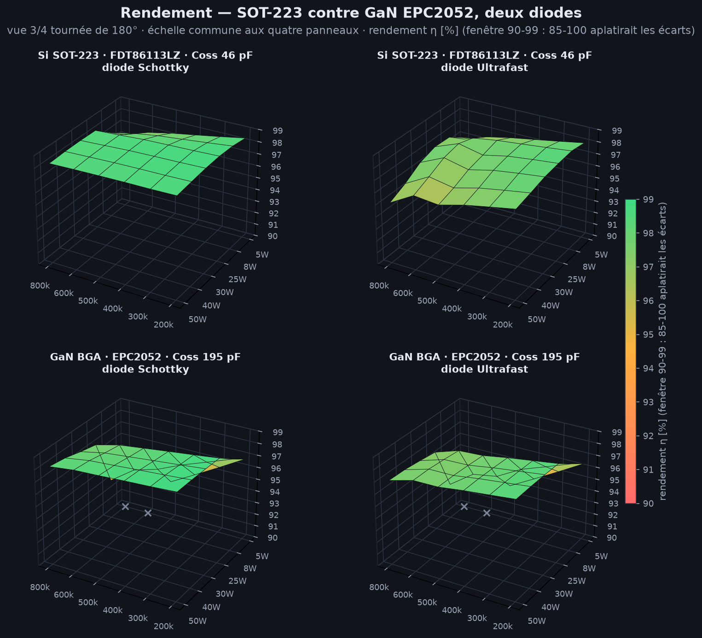
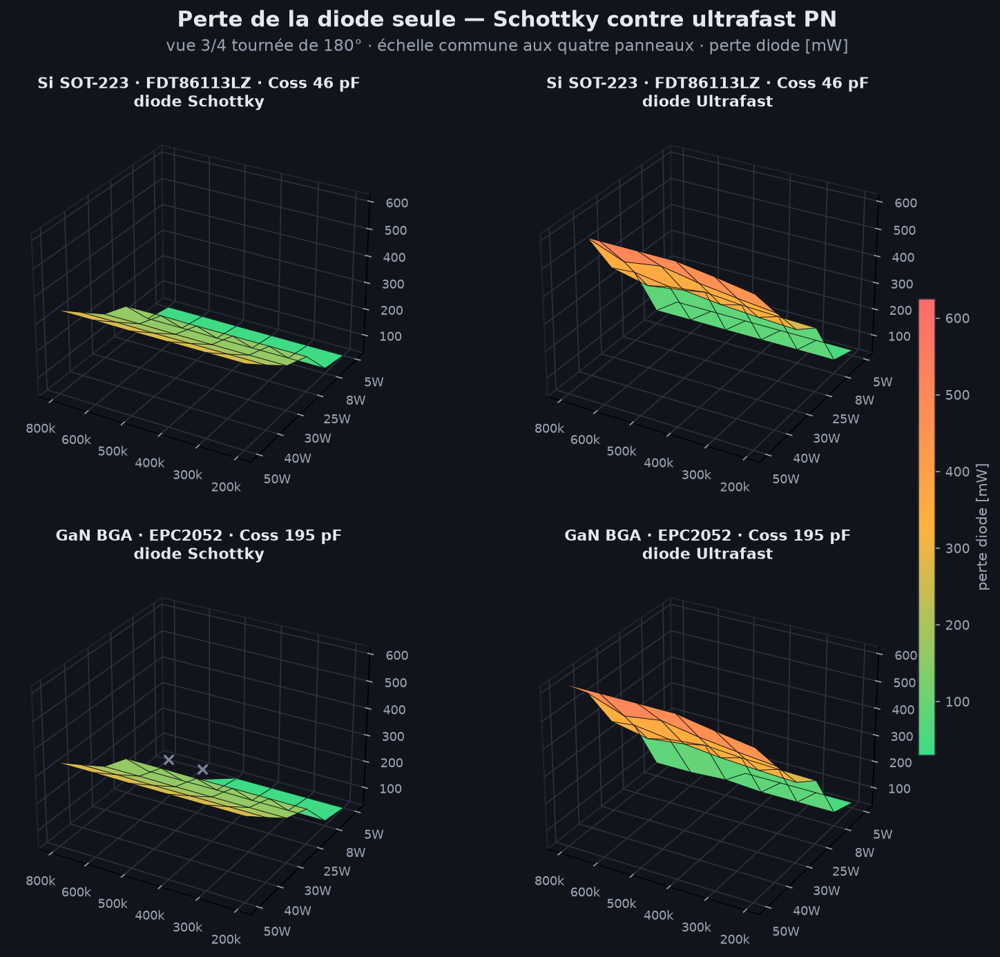

# Chapitre 2 — Technologie switch/diode

Suite directe du chapitre 1 (fréquence/inductance), qui a validé
200kHz/47µH avec switch et diode **idéaux/génériques** — explicitement
différé : « technologie transistor/diode » et « pertes de commutation ».

> **État** : switch et diode **réels** (modèles simples mais paramétrés
> sur des pièces réelles), inductance balayée sur 3 valeurs dans la même
> famille/boîtier que le chapitre 1. Pas de modèle vendeur complet
> (licence, lenteur) — c'est l'objet d'une éventuelle passe de
> raffinement ultérieure, sur moins de paramètres libres.

> ⚠️ **Le §11 étend ce chapitre à 200-800 kHz et nuance fortement sa
> conclusion §6.2** (« Si et GaN quasiment indiscernables »). Ce constat
> restait exact pour le modèle d'alors, mais ce modèle ignorait les deux
> mécanismes qui séparent réellement les technologies quand la fréquence
> monte — l'énergie $E_{oss}$ et la charge de grille. Une fois ajoutés,
> le résultat dominant n'est pas celui qu'on attendait : **le calibre du
> transistor pèse dix fois plus lourd que sa technologie.**

## 1. Pourquoi cette étude

Trois questions laissées ouvertes par le chapitre 1 :

- Le switch Si incumbent a-t-il un intérêt à être remplacé par du GaN, à
  cette classe de tension (100V) ?
- La diode : Schottky Si ou ultrafast PN Si ?
- Le rendement ne variait quasiment pas avec la fréquence au chapitre 1
  (switch/diode idéaux) — est-ce toujours vrai avec de vraies pertes de
  commutation/recouvrement ? Le choix 200kHz tient-il ?

**Pas de SiC dans ce chapitre.** Il n'existe pas de MOSFET SiC commercial
réaliste en classe 100V (le SiC cible 650V+ par nature, le marché des
Schottky SiC basse tension est quasi inexistant) — réservé à une étude à
plus haute tension.

**Redressement synchrone écarté.** À `Vout`≈80-100V, la perte `Vf` d'une
diode ne représente qu'une fraction marginale de la puissance (~0,3-1%,
référence littérature sur un cas très proche, boost 24V→200V) — gain net
classique en basse tension/fort courant (≤5V), pas ici : le
driver/switch supplémentaire coûterait probablement plus qu'il ne
ferait gagner à cette tension.

**GaN cascode et MOSFET Si superjonction écartés ici** — différence
d'architecture de driver (cascode) ou avantage trop faible à 100V
(superjonction, plus pertinent à plus haute tension) pour justifier une
3e variante.

## 2. Comparaison retenue

| | Option A | Option B |
|---|---|---|
| Switch | Si — `RD3P04BBKHRB` (incumbent) | GaN — `EPC2007` (candidat) |
| Diode | Schottky Si — `NTSV20U100CT` (candidat) | Ultrafast PN Si — `STTH2002` (candidat) |

4 combinaisons testées : (Si,Schottky) / (Si,Ultrafast) / (GaN,Schottky)
/ (GaN,Ultrafast). Fiches techniques constructeur non incluses dans ce
dépôt (licences respectives EPC/onsemi/ST/ROHM) — voir les sites des
fabricants pour les références exactes.

## 3. Modèles SPICE — simples, paramétrés sur les pièces réelles

Pas de modèle vendeur complet — un modèle simple par technologie, calibré
sur les grandeurs publiées (`switch_diode_models.py`) :

- **Switch** : `RD` = Rds_on réel (max, Tj=25°C) — Si 30mΩ, GaN 30mΩ
  (même classe, comparaison directe). `Coss` réel en shunt du nœud de
  commutation (Si 115pF, GaN 118pF — remplace la capacité numérique non
  sourcée du chapitre 1). Tension de grille PROPRE à chaque techno (Si
  10V, GaN 5V — l'EPC2007 a un VGS abs max de 6V, 10V le détruirait).
  Fronts de commande : Si — tr/tf publiés directement (14/8,7ns,
  RG=1Ω) ; GaN — **estimés** (non publiés par EPC) par le ratio QGD(GaN)/
  QGD(Si) appliqué aux tr/tf réels du Si (le palier Miller, dominé par
  QGD, gouverne la durée de transition à courant de grille ~constant) :
  tr≈3,56ns, tf≈2,21ns. **Hypothèse de modélisation documentée dans
  `switch_diode_models.py`, pas une donnée datasheet.**
- **Diode** : `IS` résolu (pas deviné) pour que le modèle statique
  ($\Large N V_T \ln(I/I_S) + I R_S$) retombe sur le `Vf` datasheet au courant de
  test publié. Schottky : `TT=0` (porteurs majoritaires, pas de
  recouvrement par nature). Ultrafast : `TT=16ns`, calé sur le `trr`
  typique publié (testé à faible courant par le fabricant — voir limites
  §9).
- **Self parasite au nœud de commutation** : ESTIMÉE (pas mesurée),
  variant modestement avec L (20/30/40nH pour 12/27/47µH — toutes les 3
  valeurs restent dans le même boîtier, donc pas de saut d'ordre de
  grandeur). Sans elle, le recouvrement inverse ne produit aucun
  dépassement de tension observable — l'intérêt de la Schottky resterait
  invisible en simulation (voir §4).

## 4. Bug/ajustement trouvé : pas de temps (`dtmax`) trop grossier

Premier essai, `dtmax` hérité du chapitre 1 (10ns) : le dépassement de
tension (`Vds_switch_max`) sortait QUASI IDENTIQUE entre Schottky et
ultrafast, alors que les pertes mesurées, elles, divergeaient déjà
nettement. Cause : l'anneau LC `Lstray`/`Coss` (~13-14ns de période avec
les valeurs de ce chapitre) et le recouvrement diode (`TT`=16ns) sont
plus courts que le pas de 10ns hérité du chapitre 1 — sous-échantillonnés,
donc lissés avant que le solveur ne puisse en capturer le pic.

**Corrigé** : `dtmax` resserré à 1ns pour le point FINAL retenu (~13
points par anneau, suffisant pour voir un pic sans être excessif).
Resserrer `dtmax` sur toute la fenêtre de réglage du chapitre 1 (4000
périodes) aurait rendu le balayage impraticable (dizaines de secondes
par point) — réglé en réduisant `Cout` à 0,22µF (10x plus petit qu'au
chapitre 1, même justification : la constante de temps `Cout×Rload` doit
rester compatible avec une fenêtre de simulation courte) et en calculant
`settle_periods`/`measure_periods` pour une durée ABSOLUE fixe (~3ms de
réglage) plutôt qu'un nombre de périodes fixe (qui ferait exploser le
temps de calcul aux basses fréquences). La recherche du duty cycle par
bissection (`find_duty2.py`) tourne avec un `dtmax` grossier (10ns) et
une fenêtre courte (150 périodes) — rapide, un `Vout` approximatif
suffit pour converger en direction — puis UNE seule simulation finale,
précise, est relancée au `D` retenu : c'est celle-ci qui fournit les
mesures réellement exploitées.

## 5. Ce que révèle le modèle (point nominal 20V→80V/40W, 200kHz, L=47µH)

| | Si+Schottky | Si+Ultrafast |
|---|---|---|
| `Vds_overshoot` | 5,08V (+6,4%) | 5,47V (+6,9%) |
| `Ploss_switch_total` | 0,234W | 0,603W (**+158%**) |
| `Ploss_diode_total` | 0,268W | 0,478W (**+79%**) |

**Constat important, pas anticipé au départ** : le dépassement de
tension crête (`Vds_overshoot`) n'est PAS le signal le plus discriminant
— il est présent mais modeste dans les deux cas (l'anneau LC de base,
présent sur CHAQUE front de commutation même sans recouvrement, domine
déjà le pic). Le signal réellement décisif est la **perte**
(commutation switch +158%, conduction+recouvrement diode +79%) : le
courant de recouvrement de la diode ultrafast circule surtout à travers
le switch pendant son propre front de montée déjà en train de sonner,
ajoutant de l'énergie dissipée plus qu'un pic de tension supplémentaire
net.

## 6. Résultats du balayage complet (240 points)

`run_sweep_tech.py` → `results/stage1_tech_sweep.csv` (non versionné,
régénérable), `make_plots_tech.py` → `plots/stage1_tech_*.png`.

**Qualité des données — 193/240 points fiables (80%)**, 47 points
rejetés des statistiques ci-dessous. Tous les rejets (sauf un) suivent
le MÊME schéma, déjà rencontré au chapitre 1 : en DCM profond, à faible
puissance (5-20W) avec les DEUX plus petites valeurs de L (12/27µH —
précisément celles qui n'étaient PAS sur la grille du chapitre 1),
`Vout` est hypersensible à `D` et la bissection grossière (150 périodes,
tolérance 2%, 8 itérations) ne converge pas en deçà de 5% sur `Vout`.
C'est un effet du balayage élargi de ce chapitre (plus de valeurs de L
testées → plus de combinaisons tombent en DCM profond à basse
puissance), pas une régression de méthode. Un point isolé (300kHz,
47µH, coin le plus dur, 40W — pourtant prédit et mesuré CCM) a aussi
échoué à converger — anomalie de recherche ponctuelle, pas corrélée au
schéma DCM ci-dessus. **Les verdicts ci-dessous utilisent uniquement les
193 points convergés.**

### 6.1 Diode : Schottky bat ultrafast PN, nettement et partout

| | Si+Schottky | Si+Ultrafast | GaN+Schottky | GaN+Ultrafast |
|---|---|---|---|---|
| η moyen (nominal, toutes L/fsw/P convergées) | **98,76%** | 97,998% | **98,76%** | 97,98% |

Écart ~0,78 point d'efficacité, **quel que soit le switch** — cohérent
avec l'essai à blanc (§5) : le courant de recouvrement de l'ultrafast
ajoute une perte réelle et mesurable, qui domine largement l'effet du
choix de switch (ci-dessous). L'écart grandit avec la fréquence (plus de
commutations par seconde = plus d'événements de recouvrement par
seconde) :

| | 100kHz | 200kHz | 300kHz | 400kHz |
|---|---|---|---|---|
| η Si+Schottky (L=47µH, 40W nominal) | 98,79% | 98,73% | 98,61% | 98,47% |
| η Si+Ultrafast (L=47µH, 40W nominal) | 98,26% | 97,48% | 96,75% | 95,96% |
| Écart | 0,53pt | 1,25pt | 1,86pt | **2,51pt** |

**Verdict diode : Schottky Si nettement préférable à l'ultrafast PN à
cette classe de tension — l'écart s'aggrave avec la fréquence,
renforçant le choix si une fréquence plus haute que 200kHz était
envisagée.**



### 6.2 Switch : Si et GaN quasiment indiscernables dans ce modèle simple

| | Si+Schottky | GaN+Schottky | Écart |
|---|---|---|---|
| η moyen (nominal, convergé) | 98,760% | 98,759% | 0,001pt |
| η moyen avec Ultrafast | 97,998% | 97,977% | 0,021pt |

**Résultat non anticipé au départ** : avec `Rds_on` et `Coss` quasiment
identiques (30mΩ/115-118pF pour les deux pièces, même classe 100V) et
une perte de conduction qui domine largement la perte de commutation à
ces niveaux de courant (quelques A), la différence de vitesse de
commutation (fronts GaN ~4x plus rapides, estimés — voir §3) ne se
traduit PAS en un gain d'efficacité mesurable dans ce modèle. **Limite
méthodologique identifiée, pas une conclusion définitive sur le GaN** :
le `dtmax`=1ns retenu pour rendre les 240 points praticables (§4)
résout correctement les fronts du Si (8,7-14ns, ~9-14 points/front)
mais SOUS-échantillonne ceux du GaN (2,2-3,6ns, ~2-4 points/front
seulement) — la perte de commutation du GaN, déjà petite en valeur
absolue (dizaines à centaines de mW sur 40W), est en dessous du bruit
de résolution temporelle à ce `dtmax`. **Ne pas conclure "le GaN n'a
aucun intérêt ici" — conclure "ce modèle simple, à ce `dtmax`, ne
permet pas de trancher" — voir §9.**

### 6.3 Fréquence : le compromis rendement/fréquence, enfin visible

Contrairement au chapitre 1 (switch/diode idéaux, rendement quasi
constant 98,6-99,5% sur les 4 fréquences), **le rendement baisse
maintenant clairement avec la fréquence** une fois les pertes de
commutation/recouvrement réelles introduites — exactement ce que le
chapitre 1 avait annoncé comme différé ici :

| | 100kHz | 200kHz | 300kHz | 400kHz |
|---|---|---|---|---|
| η moyen (40W nominal, 4 combinaisons, convergé) | **98,49%** | 98,33% | 98,00% | 97,55% |

**Tension avec le verdict CCM/DCM du chapitre 1** : 100kHz reste écarté
pour la même raison déjà établie (le coin le plus dur à 40W reste en
DCM à cette fréquence même à L=47µH, confirmé à nouveau ici). **200kHz
reste donc le meilleur compromis** parmi les fréquences qui atteignent
le CCM sur les 3 coins — pas la fréquence la plus efficace dans
l'absolu (100kHz le serait, mais au prix du retour en DCM profond au
coin le plus dur), mais la plus basse qui tienne la stratégie
DCM-léger/CCM-fort du chapitre 1 tout en limitant la perte de
recouvrement diode. **L'hypothèse de départ (200kHz) reste confirmée,
avec une justification plus complète qu'au chapitre 1** (qui ne pouvait
pas encore voir ce compromis).



### 6.4 Inductance : le choix du chapitre 1 n'est pas remis en cause

Les valeurs plus petites (12/27µH) souffrent d'un défaut de convergence
numérique sévère en DCM profond (voir qualité des données ci-dessus)
sans apporter de bénéfice de rendement visible sur les points qui
CONVERGENT (écarts <0,1 point entre les 3 valeurs de L à
puissance/fréquence égales, dominés par le bruit plutôt que par un effet
réel de L sur la techno switch/diode — attendu : L ne change pas
directement `Rds_on`/`Vf`/`TT`, seulement le courant crête/efficace,
déjà étudié au chapitre 1). Rien dans ce chapitre ne contredit le choix
d'inductance déjà validé au chapitre 1.

### 6.5 Dépassement de tension (`Vds_overshoot`)

| | Schottky | Ultrafast |
|---|---|---|
| Moyenne (toutes configs) | 3,32V | 3,69V |

Confirme la tendance de l'essai à blanc (§5) : l'ultrafast a un
dépassement un peu plus élevé, mais l'écart (~0,4V) reste modeste
devant l'anneau de base déjà présent sans recouvrement — **le signal
décisif reste la perte, pas le pic de tension** (§6.1).

## 7. Synthèse — quelle combinaison retenir

Intègre rendement, taille, EMI, souplesse et stabilité — pas seulement
le rendement isolé des §6.1-6.2.

### Diode : Schottky (`NTSV20U100CT`), les 4 critères convergent

| Critère | Schottky | Ultrafast |
|---|---|---|
| Rendement | 98,76% moyen | 97,998% moyen (écart croissant avec fsw : 0,53pt à 100kHz → 2,51pt à 400kHz) |
| EMI (proxy `Vds_overshoot`) | 3,32V moyen | 3,69V moyen |
| Souplesse | Pas de recouvrement par nature (`TT=0`), indépendant du `di/dt` réel | `trr` daté à faible courant (1A), pas au point de fonctionnement réel (§9) |
| Stabilité | Résultats lisses à toutes fréquences/L testées | Partage switch/diode numériquement instable (zigzag confirmé §9, pas un artefact de lecture) |

Aucun des quatre critères ne penche pour l'ultrafast à cette classe de
tension.

### Switch : rester sur Si (`RD3P04BBKHRB`) — pas un verdict contre le GaN

| Critère | Si | GaN |
|---|---|---|
| Rendement | Indiscernable du GaN ici (écart <0,02pt) — **non tranché**, pas une égalité prouvée (§6.2, limite de `dtmax`) |
| Taille | TO-252 | Puce nue/CSP — réellement plus petit, avantage non quantifié ici mais physiquement acquis (datasheet EPC2007 p.1) |
| EMI | Fronts 14/8,7ns (publiés) | Fronts ~4x plus rapides (estimés, §3) — *a priori* plus de contenu harmonique HF |
| Souplesse de commande | `VGS` jusqu'à 10V | `VGS` abs. max **6V** (datasheet) — marge de commande plus étroite |

Le rendement ne départage pas, et les deux critères qui restent (EMI,
souplesse de commande) penchent plutôt pour le Si à ce stade. **Pas une
conclusion contre le GaN** — juste pas de raison de migrer sans un
modèle plus fin qui montrerait un vrai gain de rendement à haute
fréquence (précisément là où l'avantage GaN est censé apparaître, et
précisément ce que ce modèle ne peut pas trancher — §9).

### Fréquence : 200kHz confirmé, cinq critères à l'appui

| | 100kHz | 200kHz | 300kHz | 400kHz |
|---|---|---|---|---|
| Rendement moyen (4 combinaisons) | 98,49% | 98,33% | 98,00% | 97,55% |
| Mode au coin dur (24V→100V/40W, L=47µH) | **DCM** ⚠ | CCM | CCM* | CCM |
| Marge Isat (L=47µH, 40W nominal) | ×1,46 | ×1,87 | ×2,03 | ×2,10 |
| Marge Irms (L=47µH, 40W nominal) | ×4,85 | ×5,20 | ×5,14 | ×5,06 |
| `Vds_overshoot` moyen, proxy EMI (toutes configs) | **6,55V** | 3,25V | 2,31V | 1,90V |
| Écart Schottky/Ultrafast (sensibilité au choix diode) | 0,53pt | 1,25pt | 1,86pt | **2,51pt** |

*300kHz au coin dur : point non convergé (§9, `D`=0,625 au lieu de
~0,76 attendu, `Vout` mesuré 64,19V) — CCM prédit et cohérent partout
ailleurs, non confirmé numériquement à ce point précis.

**100kHz** a le meilleur rendement mais échoue le critère de souplesse
le plus dur (reste en DCM au coin le plus exigeant — la stratégie
DCM-léger/CCM-fort du chapitre 1 n'est pas tenue partout) et a le pire
EMI mesuré ici (overshoot 2 à 3x plus élevé qu'aux autres fréquences).
**Écarté**, comme au chapitre 1.

**400kHz** a la meilleure marge Isat et le meilleur EMI, mais le pire
rendement et surtout la plus forte sensibilité au choix de diode
(2,51pt) — elle amplifie l'enjeu d'un mauvais choix plutôt que de le
tolérer. Candidate seulement si la compacité devient une contrainte
dure.

**200kHz reste le meilleur compromis** : rendement proche du maximum
(-0,16pt vs 100kHz), CCM atteint sur les 3 coins, EMI déjà très réduit
par rapport à 100kHz, marge thermique confortable, et sensibilité
modérée au choix de diode (1,25pt).

### Recommandation

**200kHz, Si+Schottky, L=47µH (SER2211-473)** — la combinaison déjà
retenue après les deux chapitres. Rien dans cette synthèse ne la remet
en cause ; chaque critère nouvellement intégré (EMI, souplesse,
stabilité) converge vers elle plutôt que de l'affaiblir.

**Seule porte ouverte** : un GaN à fréquence plus haute (300-400kHz)
pourrait rattraper son déficit de taille par un vrai gain de
rendement — mais ça demande le modèle plus fin déjà identifié comme
hors périmètre ici (§9), pas une conclusion à tirer de ces données.

> **Porte franchie au [§11](#11-extension-200-800-khz--le-calibre-avant-la-technologie).**
> Le modèle plus fin a été construit ($E_{oss}$ par intégration de la
> courbe $C_{oss}(V)$, charge de grille), et la plage étendue à 800 kHz.
> Réponse : le GaN gagne bien, mais **0,2 point seulement** à calibre
> optimal — pendant qu'un mauvais calibre en coûte **2,3**. La
> recommandation 200 kHz tient pour ce point de fonctionnement ; au-delà
> de 400 kHz c'est le **boîtier** qu'il faut changer avant la technologie.

## 8. Sélection de candidats réels (TO-252)

Suite au choix Si+Schottky, recherche de candidats réels pour
remplacer les pièces génériques de simulation — contraintes : boîtier
**TO-252**, facilement disponible, performances excellentes.
Inductance **SER2211 déjà retenue, inchangée**.

**Démarche** : recherche par fabricant (pas par distributeur
d'abord — le distributeur sert à vérifier la disponibilité une fois
les candidats identifiés) auprès de fabricants reconnus pour ce
segment (Infineon, Vishay, onsemi pour le switch ; onsemi, Vishay,
Diodes Incorporated pour la diode), puis **lecture directe de la fiche
technique officielle de chaque candidat** (pas d'un résumé de moteur
de recherche) pour en extraire `Rds(on)`/`Qg`/`tr`/`tf` (switch) ou
`Vf`/`Cj` (diode) avec leurs conditions de test exactes — même
discipline que le reste de ce chapitre, aucune valeur retenue sans
l'avoir lue à la source.

### Switch (N-MOS 100V, TO-252) — trois candidats, vérifiés sur fiche officielle

| | Infineon [`IPD050N10N5`](https://infineon.com/cms/en/product/power/mosfet/n-channel/ipd050n10n5) | Vishay [`SUD70090E`](https://www.vishay.com/docs/65437/sud70090e.pdf) | onsemi [`NVD6824NL`](https://www.onsemi.com/products/discrete-power-modules/mosfets/low-medium-voltage-mosfets/nvd6824nl) |
|---|---|---|---|
| `Rds(on)` | 4,3mΩ typ / 5,0mΩ max @10V/40A | 7,4mΩ typ / 8,9mΩ max @10V/20A | 16,5mΩ typ / 20mΩ max @10V/20A |
| `Qg` total | 51nC @0-10V/40A | 33nC @10V/20A | 66nC @10V/20A |
| `tr`/`tf` | 7ns / 7ns @50V/40A/RG=1,6Ω | 27ns / 45ns @50V/10A/RG=1Ω | 55ns / 42ns @80V/20A/RG=2,5Ω |
| `ID` continu | 80A (Tc=25°C) | 50A (limité boîtier) | 41A (Tc=25°C) |
| Boîtier | P-TO252-3 | TO-252 | DPAK (Case 369C) |
| Note | Meilleur `Rds(on)` ET fronts les plus rapides des trois | Compromis `Qg`/vitesse intermédiaire | AEC-Q101 ; `Rds(on)` le plus faible gain vs l'incumbent `RD3P04BBKHRB`, mais encore ×1,5 mieux |

Les trois battent l'incumbent `RD3P04BBKHRB` (`Rds(on)` 23mΩ typ/30mΩ
max) de ×1,5 à ×5,3 — net gain sur la perte de conduction qui domine
le bilan à ces niveaux de courant (§6.2).

### Diode (Schottky ~100V, TO-252/DPAK) — trois candidats, vérifiés sur fiche officielle

| | onsemi [`MBRD5H100T4G`](https://www.onsemi.com/products/discretes-drivers/diodes-rectifiers/schottky-diodes-schottky-rectifiers/mbrd5h100t4g) | Vishay [`VS-6CWQ10FN-M3`](https://www.vishay.com/en/product/93318/) | Diodes Inc [`SBR15U100CTL`](https://www.diodes.com/part/view/SBR15U100CTL) |
|---|---|---|---|
| `Vf` max | 0,71V @5A/25°C (0,60V@125°C) | 0,63V @3A/125°C (0,81V@25°C) | 0,80V @7,5A/25°C (0,65V@125°C) |
| Configuration | Simple (pin 1 NC) | Double cathode commune, 3,5A/jambe | Double cathode commune |
| `Cj` | ~150-1000pF (dépend `VR`, graphe) | 92pF @5V | 200pF @4V |
| Note | Le plus simple à câbler, pas de jambe inutilisée | `Vf` le plus bas au point chaud | Technologie SBR (hybride MOS/Schottky), **avalanche-testée** (`EAS`=192mJ) — tolère un dépassement que la Schottky pure ne tolère pas |

Les trois sont de vraies Schottky (ou assimilées, SBR) — pas de
recouvrement inverse, même argument que celui qui a fait gagner
`NTSV20U100CT` en simulation (§6.1).

### Non vérifié à ce stade

Disponibilité/prix réels chez un distributeur (Digikey, Mouser) pas
encore croisés pour ces six références précises — seulement les
fiches techniques officielles lues directement. À faire avant de
figer un choix final.

### Risque EMI identifié — traité au §9

Le choix ci-dessus ne traite que le rendement/taille/stabilité. Un
risque EMI (`dV/dt`/`dI/dt` des switchs rapides, anneau de résonance
de la boucle chaude avec les inductances/capacités parasites du PCB
et des composants eux-mêmes) doit aussi encadrer le choix final — voir
§9 pour l'estimation des pertes natives des 3 candidats switch et le
rôle des 3 candidats diode dans l'anneau de boucle.

## 9. EMI/résonance — pertes natives des 3 candidats switch, rôle de la diode dans l'anneau de boucle

Un switch rapide (meilleur `Rds(on)` ET fronts rapides, cas de
l'`IPD050N10N5` ci-dessus) peut coûter plus cher en CEM qu'il ne
rapporte en pertes — un switch plus lent avec moins de perte `Coss`
pourrait être préférable. Côté diode, sa capacité de jonction
participe avec les inductances parasites de la boucle chaude à un
système résonant. Démarche : d'abord évaluer si le compromis existe
réellement (pertes, dépassement de tension) avant de changer quoi que
ce soit au choix du §8.

### `Qgd`/`Cj` vérifiés à la source, pas réutilisés tels quels

`Qgd` n'était pas encore extrait au §8 (qui ne donnait que `Qg`
total) — relu directement sur chaque fiche officielle : `IPD050N10N5`
10nC typ/16nC max (`VDD`=50V/`ID`=40A) ; `SUD70090E` 7,5nC typ
(`VDS`=50V/`VGS`=10V/`ID`=20A) ; `NVD6824NL` 18nC typ
(`VGS`=10V/`VDS`=80V/`ID`=20A).

`Cj` diode relue au point proche du régime réel (~80-100V), pas le
point tabulé à bas `VR` souvent seul publié en table — piège
vérifié : `VS-6CWQ10FN-M3` publie 92pF à `VR`=5V en table, mais sa
courbe `C(VR)` tombe à ~28pF au point réel (~90V), un facteur ~3,3 de
différence. Les deux autres candidats (`MBRD5H100T4G` ~130pF,
`SBR15U100CTL` ~53pF au même point, ce dernier extrapolé au-delà de
la courbe tracée) n'avaient de toute façon qu'un graphe, pas de table.

### Pertes à vitesse native (pas ralentie)

Méthode : pas les `tr`/`tf` publiés (conditions de test différentes
d'un fabricant à l'autre, piège déjà signalé §6.2), mais recalculés
depuis `Qgd` et le driver de grille déjà retenu pour cet étage (4A pic
source / 6A pic puits) :

$$
\Large t_{on} = \frac{Q_{gd}}{I_{source}} \qquad t_{off} = \frac{Q_{gd}}{I_{sink}}
$$

$$
\Large E_{on} = \tfrac{1}{2}\, V_{ds}\, I_{valley}\, t_{on} \qquad
E_{off} = \tfrac{1}{2}\, V_{ds}\, I_{peak}\, t_{off} \qquad
P_{sw} = (E_{on} + E_{off})\, f_{sw}
$$

Aucune nouvelle simulation : calculé directement depuis les points
déjà mesurés au §6 (switch=Si/diode=Schottky générique, 20V→80V/40W,
L=47µH, les 4 fréquences) — le courant au point de fonctionnement ne
dépend pas du `Rds(on)`/`Qgd` réellement monté.

| Switch | `fsw` | `P_cond` (W) | `Psw` (W) | `P_total` (W) | `Psw`/`Ptotal` |
|---|---|---|---|---|---|
| `IPD050N10N5` | 100kHz | 0,015 | 0,030 | 0,045 | 66% |
| `IPD050N10N5` | 200kHz | 0,013 | 0,063 | 0,076 | 82% |
| `IPD050N10N5` | 400kHz | 0,014 | 0,138 | 0,152 | 91% |
| `SUD70090E` | 100kHz | 0,026 | 0,022 | 0,049 | 46% |
| `SUD70090E` | 200kHz | 0,023 | 0,047 | 0,070 | 67% |
| `SUD70090E` | 400kHz | 0,025 | 0,103 | 0,128 | 81% |
| `NVD6824NL` | 100kHz | 0,059 | 0,054 | 0,113 | 48% |
| `NVD6824NL` | 200kHz | 0,052 | 0,113 | 0,165 | 69% |
| `NVD6824NL` | 400kHz | 0,055 | 0,248 | 0,303 | 82% |



**Constat** : même à vitesse native, la commutation **domine** le
bilan (66-91% selon candidat/fréquence) — à l'opposé du §6.2, qui
trouvait la conduction dominante avec les modèles génériques. Mais en
absolu, `P_total` reste **très faible** (45 à 303mW sur 40W) : les 3
candidats sont largement surdimensionnés en courant pour cette
application. La rapidité de l'`IPD050N10N5` ne coûte donc pas
significativement en pertes absolues.

> **⚠ Ce calcul ignore la perte de `Coss` — trompeur, voir plus bas.**
> Vérifié en SPICE complet, le classement des 3 switchs s'inverse :
> `NVD6824NL`, le pire ici, est en réalité le moins dissipatif des 3 —
> la perte dominante vient de `Coss` (déchargé dans le canal à chaque
> amorçage), pas de `Qgd` comme supposé ici.

### Boucle chaude : estimation par placement (pré-routage)

Carte déjà placée mais pas encore routée (aucune géométrie de piste
réelle disponible) — estimation par placement + littérature
uniquement, sert de budget cible, à revérifier au routage. Périmètre
mesuré directement sur le placement réel de l'inductance/switch/diode
de cet étage : **52mm**. Heuristique nH/cm (carte sans plan de masse
rapproché actuellement) : ~8-12nH/cm pour une boucle sans retour
proche, ordre de grandeur courant en littérature de layout pour
boucles de commutation ; un retour soigné au routage viserait plutôt
~3-5nH/cm. Fourchette résultante : **42-62nH** (état actuel) contre
**16-26nH** (cible routage).

### Calcul à la main vs confirmation SPICE

Calcul :

$$
\Large f_0 = \frac{1}{2\pi\sqrt{L_{boucle}\,(C_{oss}+C_j)}} \qquad
V_{pic} = V_{out} + I_{pk,L}\sqrt{\frac{L_{boucle}}{C_{oss}+C_j}}
$$

Confirmation SPICE : les 9
combinaisons switch×diode, point nominal, `Lstray`=52nH (état actuel) :

| Switch | Diode | `f0` calculé | `Vpic` calculé | `Vds` simulé | Écart |
|---|---|---|---|---|---|
| `IPD050N10N5` | `MBRD5H100T4G` | 26,5MHz | 104,1V | 83,9V | -19% |
| `IPD050N10N5` | `VS-6CWQ10FN-M3` | 28,8MHz | 106,1V | 83,8V | -21% |
| `SUD70090E` | `MBRD5H100T4G` | 22,3MHz | 100,3V | 84,1V | -16% |
| `NVD6824NL` | `VS-6CWQ10FN-M3` | 47,6MHz | 123,2V | 83,5V | -32% |

(tableau complet des 9 combinaisons : voir le script de reproduction)



**Écart systématique, toujours dans le même sens** (calculé > simulé,
16 à 32%) — pas un écart aléatoire, mais un artefact de modélisation
identifié : la formule à la main suppose que tout le courant
d'inductance charge le réservoir `Lstray`-`C` depuis zéro, comme si
aucun chemin de roue libre n'existait. En réalité, les 3 candidats
diode sont des Schottky/SBR **sans recouvrement inverse** (même
argument qui a fait gagner `NTSV20U100CT` au §6.1) : dès que le switch
bloque, la diode conduit quasi instantanément et **clampe** le nœud de
commutation près de `Vout`, consommant l'essentiel de l'énergie qui
aurait fait sonner le réservoir LC. La formule à la main reste une
**borne supérieure conservatrice utile**, mais surestime le risque réel
pour ce jeu de candidats.

**Dépassement réel observé** : `Vds_switch_max` ≈ 83,5-84,1V pour
`Vout_avg` ≈ 78,5-80V, soit **4 à 5,5V (~5-7%)** — quel que soit le
candidat. Sensibilité à `Lstray` testée (52nH vs 21nH cible routage) :
dépassement **quasi identique** — le clamp par la diode rend le
dépassement insensible à `Lstray` dans cette fourchette.

### Verdict

- **Risque de dépassement de tension sur le switch : faible**, grâce
  au clamp quasi-instantané des diodes Schottky/SBR retenues.
- **Risque dI/dt / spectre conduit : non tranché par cette passe** —
  le faible dépassement de tension ne dit rien du `dI/dt` réel dans la
  boucle, grandeur pertinente pour le spectre CEM conduit, non mesurée
  ici.
- **Les pertes différencient bien les 3 candidats switch, mais pas
  dans le sens anticipé** (ni par la datasheet, ni par le calcul à la
  main — tous les deux démentis par la simulation complète, voir plus
  bas). Le dépassement de tension, lui, reste insensible au candidat.

### Choix définitif étage 1 — `NVD6824NL` + `VS-6CWQ10FN-M3`

**Avertissement méthodologique d'abord, le résultat en dépend
directement** : le calcul à la main ci-dessus et le classement
datasheet (`Rds(on)`/`Qgd`) se sont révélés **tous les deux trompeurs**
une fois vérifiés par simulation SPICE complète des 3 candidats réels,
dans le vrai circuit, au point nominal (20V→80V/40W, 200kHz, diode
fixée) :

| Switch | `Rds(on)` (datasheet) | `P_total` estimé à la main | `Ploss_switch_total` **SPICE** (diode `MBRD5H100T4G`) | η SPICE |
|---|---|---|---|---|
| `IPD050N10N5` | 4,3mΩ (meilleur) | 76,3mW (2e) | 497,5mW (2e) | 97,79% |
| `SUD70090E` | 7,4mΩ (2e) | 70,2mW (meilleur) | **743,6mW (pire)** | 97,27% |
| `NVD6824NL` | 16,5mΩ (pire) | 164,6mW (pire) | **279,7mW (meilleur)** | **98,35%** |

**Le classement s'inverse presque totalement entre l'estimation à la
main et la simulation réelle.** Confirmé à deux résolutions temporelles
(`dtmax`=1ns et 0,2ns, écart <3%) : `NVD6824NL`, le pire sur
`Rds(on)`, est en réalité **le switch le moins dissipatif des 3**
(quasi 2x moins que `SUD70090E`).

**Cause : la perte vient de `Rds(on)` ET de `Coss`, pas de `Qgd` comme
le supposait le calcul à la main.** `Coss` est une capacité non
linéaire (elle décroît quand `VDS` augmente) ; à chaque amorçage,
l'énergie qu'elle a accumulée se décharge dans le canal du switch —
perte standard, intégrale de `C(V)` sur la charge/décharge réelle,
approximée ici par $P_{Coss} \approx \tfrac{1}{2} C_{oss} V_{ds}^2
f_{sw}$ :

| Switch | `Coss` | `P_{Coss}` calculé | Mesuré SPICE | Reste (conduction + recouvrement) |
|---|---|---|---|---|
| `IPD050N10N5` | 560pF | 354,5mW | 497,5mW | 143,0mW |
| `SUD70090E` | 845pF | 537,6mW | 743,6mW | 206,0mW |
| `NVD6824NL` | 187pF | 117,6mW | 279,7mW | 162,1mW |

Le reste (conduction + recouvrement) est similaire pour les 3
(143-206mW) — c'est `P_{Coss}`, qui varie de 118 à 538mW selon le
`Coss` de chaque candidat, qui explique l'écart entre eux. `NVD6824NL`
a le `Coss` le plus petit des 3 (187pF, lu à `VDS`=25V — probablement
encore plus bas au point réel ~80V) : d'où sa victoire malgré son
`Rds(on)` le plus mauvais.

**Diode, vérifiée avec le switch retenu, mêmes deux résolutions** :

| Diode | `Ploss_switch_total` | `Ploss_diode_total` | Total | η |
|---|---|---|---|---|
| `MBRD5H100T4G` | 279,7mW | 326,5mW | 606,2mW | 98,35% |
| `VS-6CWQ10FN-M3` | **215,2mW** | 303,2mW | **518,4mW** | **98,59%** |
| `SBR15U100CTL` | 224,7mW | 353,1mW | 577,8mW | 98,42% |

**`VS-6CWQ10FN-M3` l'emporte sur la perte totale réelle**, malgré sa
configuration double cathode commune (câblage des deux anodes en
parallèle nécessaire, pas un simple câblage).

**Compromis EMI assumé, pas ignoré** : cette combinaison a aussi le
`f0` calculé **le plus haut des 9** (47,6MHz). Les gabarits CEM
**conduite** usuels (CISPR 22/32 classe B) couvrent 150kHz-30MHz — à
47,6MHz, cet anneau tombe **hors de la bande conduite**, plutôt dans
le registre du rayonné (hors périmètre de cette passe). Les
combinaisons à `f0` plus bas (22-29MHz) tombent elles plus près de la
limite haute de la bande conduite — potentiellement plus visibles sur
un spectre conduit, pas moins. Jugement, pas une mesure — à confirmer
par le spectre conduit simulé ci-dessous.

**Choix retenu : switch `NVD6824NL`, diode `VS-6CWQ10FN-M3`** — sur la
base de la perte réelle mesurée en SPICE, pas du classement datasheet
ni de l'estimation à la main.

### Vérification du choix retenu sur toute la plage de fréquence

Rebalayage aux 4 fréquences candidates avec `NVD6824NL`+`VS-6CWQ10FN-M3` :

| `fsw` | `Vout` | η | `Ploss_switch` | `Ploss_diode` | `Vds_max` |
|---|---|---|---|---|---|
| 100kHz | 80,21V | **98,73%** | 145,2mW | 309,7mW | 89,7V |
| 200kHz | 79,29V | 98,59% | 240,6mW | 302,1mW | 84,4V |
| 300kHz | 79,99V | 98,41% | 330,8mW | 304,8mW | 83,7V |
| 400kHz | 80,44V | 98,24% | 393,5mW | 306,3mW | 83,4V |

Tendance propre et monotone — confirme que le choix n'est pas un
artefact du seul point 200kHz. Rendement supérieur à la comparaison
générique du §6.3 (98,33% à 200kHz, Si/Schottky générique) :
**98,59% avec les composants réels retenus**. 200kHz reste la
fréquence retenue (verdict CCM/DCM du chapitre 1 non remis en cause).

### Spectre CEM conduit estimé (réseau LISN + FFT)

LISN simplifié (une branche, PAS un réseau CISPR 16-1-2 complet à 2
branches) ajouté dans `gen_boost2_tech.py` (`add_lisn=True`) : sépare
la source idéale du convertisseur pour mesurer la tension de bruit
conduit sur une impédance connue (50Ω) — `L_lisn`=50µH, branche mesure
`C`=0,1µF+`R`=50Ω, branche basse fréquence `R`=1kΩ+`C`=1µF.

**Piège trouvé et corrigé à l'implémentation** : `L_lisn` en série avec
`Cin`=220µF (déjà présent, valeur non sourcée) forme un filtre LC quasi
non amorti — la simulation ne retombe pas en régime établi dans la
fenêtre de mesure (`Pin_avg`/`Vds_switch_max` mesurés complètement
faux, 334W/125V constatés avant correction). **Corrigé** par une
résistance série réaliste sur `L_lisn` (1Ω, proche de l'amortissement
critique pour `L`=50µH/`C`=220µF, valeur de bobinage LISN réaliste).

Spectre obtenu (FFT `numpy` sur `V(n_lisn_meas)`, fenêtrage Hann, point
nominal 20V→80V/40W, 200kHz, `NVD6824NL`+`VS-6CWQ10FN-M3`) :



| Fréquence | Niveau | Repère CISPR B (illustratif) |
|---|---|---|
| `fsw`=200kHz (fondamental) | **65,9dBµV** | 56dBµV — **dépasse de ~10dB** |
| 2·`fsw`=400kHz | 51,9dBµV | 56dBµV — en-dessous |
| 3·`fsw`=600kHz | 41,0dBµV | 56dBµV — en-dessous |
| `f0` résonance ≈47,5MHz | négligeable | hors bande conduite (>30MHz) |

**Confirme le raisonnement ci-dessus** : la résonance LC ne laisse
aucune trace visible dans la bande conduite usuelle (150kHz-30MHz).
**Nouveau constat** : c'est le fondamental de découpage lui-même
(200kHz) qui dépasse le gabarit illustratif, pas l'anneau de résonance
— si un filtrage CEM conduit est nécessaire, c'est ce fondamental
qu'il faudrait atténuer.

**Limites explicites** : LISN simplifié (pas conforme CISPR 16-1-2),
gabarit CISPR 22/32 classe B choisi par commodité (mains AC, pas
nécessairement applicable à une alimentation DC), aucun filtre
d'entrée modélisé, pas une mesure certifiée.

### Ce qui reste ouvert sur ce point

- **Estimation de boucle pré-routage** — fourchette de littérature,
  à revérifier une fois la boucle réellement routée.
- **`Coss` du `NVD6824NL`** lu à `VDS`=25V (pas 50-80V comme les 2
  autres candidats) — probablement surestimé au point réel, sans
  autre donnée publiée pour corriger. N'a pas empêché ce candidat de
  l'emporter sur la perte réelle mesurée (ci-dessus).
- **Extraction de la période d'oscillation depuis la forme d'onde** —
  abandonnée après une anomalie d'outillage sans rapport avec les
  résultats ; la comparaison `Vpic`/`Vds_switch_max` reste la
  vérification retenue, `f0` n'est donné qu'au titre du calcul à la
  main.
- **Candidats diode avec recouvrement réel** non retestés — écartés
  dès le §6.1, mais le clamp qui explique le faible dépassement ici
  dépend spécifiquement de l'absence de recouvrement.

## 10. Ce qui reste ouvert / différé

- **Verdict switch (Si vs GaN) non tranché, pas négatif** — le `dtmax`
  =1ns nécessaire pour tenir les 240 points en temps praticable
  sous-échantillonne les fronts GaN (2,2-3,6ns estimés, voir §6.2). Une
  comparaison fiable demanderait soit un `dtmax` plus fin sur un nombre
  de points réduit (ex. seulement la techno diode déjà gagnante, les 4
  fréquences, L=47µH — 2 switch x 4 fsw = 8 points au lieu de 240),
  soit une passe de raffinement vendeur. **Ne pas répéter la conclusion
  "Si et GaN ne changent rien" hors de ce modèle et de ce `dtmax`.**
- **47/240 points rejetés pour non-convergence** (§6) — tous en DCM
  profond à faible puissance avec les 2 plus petites valeurs de L. Un
  point isolé (300kHz/47µH/coin le plus dur/40W) a aussi échoué sans ce
  schéma — anomalie de recherche, à reprendre si ce point précis
  redevient pertinent.
- **Le partage switch/diode de la perte totale est numériquement bruité
  à `dtmax`=1ns — confirmé par re-simulation, pas juste suspecté.**
  Repéré en relisant `plots/stage1_tech_switching_loss.png` (colonne de
  droite, Si+Ultrafast, L=47µH) : `Ploss_diode_recovery_est` zigzague
  avec la fréquence (0,030/0,074/0,033/0,091W aux 4 fréquences) au lieu
  d'évoluer progressivement. Diagnostic en deux temps :
  1. **Ce n'est pas qu'un artefact de la décomposition conduction/
     recouvrement** (l'estimateur `Vf` statique à `Iout_avg` constant
     reste une simplification réelle, séparée) — `Ploss_diode_total`,
     la mesure SPICE **directe**, zigzague déjà elle-même
     (0,4276/0,4848/0,4359/0,4983W aux 4 fréquences), alors que
     `Ploss_switch_total` et le rendement, mesurés dans la même fenêtre,
     restent lisses. Le partage entre les deux intégrales
     (`Id(M1)*V(n_sw)` et `I(D1)*(V(n_sw)-V(vout))`) est donc instable,
     pas seulement le post-traitement qui en dérive.
  2. **Confirmé par re-simulation ciblée** des 4 points (Si+Ultrafast,
     L=47µH, 100-400kHz) à `dtmax`=0,2ns (5x plus fin) : la série
     `Ploss_diode_total` devient quasi monotone (0,427/0,445/0,441/
     0,471W) — le zigzag se résorbe très largement. `Ploss_switch_total`
     reste lisse aux deux résolutions, mais se décale de -12 à -14% aux
     deux fréquences les plus basses — un biais réel à `dtmax`=1ns, pas
     seulement du bruit, mais qui n'affecte pas la forme de la courbe.
  **Conséquence** : le graphique `stage1_tech_switching_loss.png` (les
  deux colonnes, pas seulement le recouvrement diode) est à lire comme
  qualitatif — ordre de grandeur, tendance générale avec la fréquence —
  pas comme des valeurs absolues fiables. Refaire les 240 points à
  `dtmax`=0,2ns est impraticable ici (5x le temps déjà mesuré à 1ns, de
  l'ordre de plusieurs heures) ; non fait dans ce chapitre. **Les
  verdicts du §6.1/§6.2 restent valables** : ils comparent le rendement,
  mesuré directement et resté lisse aux deux résolutions testées — pas
  la décomposition switch/diode.
- **Point de test `trr` de l'ultrafast à faible courant** — le `trr`
  datasheet (16ns) est mesuré à un courant bien plus faible que le
  courant nominal du composant ou le point de fonctionnement réel de ce
  chapitre. Le `TT` du modèle simple hérite de cette limite — une
  calibration plus fine nécessiterait le `Qrr` à un courant/di-dt plus
  représentatif (lecture graphique non faite ici).
- **Auto-échauffement non modélisé** — `Rds_on`/`Vf` utilisés à Tj=25°C
  (valeur datasheet directe), pas de boucle thermique (même limite que
  le chapitre 1).
- **Passe de raffinement avec modèles vendeur complets** — suite logique
  une fois la techno gagnante connue, sur moins de paramètres libres.
  Hors périmètre de ce chapitre.

## 11. Extension 200-800 kHz — le calibre avant la technologie

Le §7 se terminait sur une porte explicitement laissée ouverte : *« un GaN
à fréquence plus haute pourrait rattraper son déficit de taille par un
vrai gain de rendement — mais ça demande le modèle plus fin déjà identifié
comme hors périmètre »*. Cette section franchit cette porte. Le modèle plus
fin a été construit, et la réponse n'est pas celle qu'on attendait.

### 11.1 Ce que le modèle d'origine ne pouvait pas voir

Le §6.2 concluait que Si et GaN sont « quasiment indiscernables ». Ce
constat était exact **pour ce modèle-là**, mais pour une raison en partie
artificielle : les deux pièces retenues sont appariées sur `Rds_on`
(30 mΩ) **et** sur `Coss` (115 contre 118 pF) — les deux seuls paramètres
que le modèle capturait. Deux mécanismes manquaient, et tous deux croissent
linéairement avec la fréquence :

$$\Large E_{oss}(V)=\int_0^V C_{oss}(v)\,v\,dv \qquad P_{grille}=Q_g V_{gs} f_{sw}$$

**La relation de base, et son sens.** $Q_{oss}$ est l'intégrale de
$C_{oss}$, donc $C_{oss}=dQ_{oss}/dV$ ; et comme $C_{oss}=C_{gd}+C_{ds}$,
on a $Q_{oss}=Q_{gd}+Q_{ds}$ (l'EPC2007C l'imprime d'ailleurs tel quel sur
sa fiche). C'est de là qu'on extrait l'exposant $\gamma$ d'une loi
$C_{oss}(v)=C_{oss}(50)(50/v)^\gamma$ quand le constructeur publie le
couple $(C_{oss}, Q_{oss})$ :

$$\Large Q_{oss}(50)=\frac{C_{oss}(50)\cdot 50}{1-\gamma}\;\Longrightarrow\;\gamma=1-\frac{50\,C_{oss}(50)}{Q_{oss}(50)}$$

**Le piège du point unique.** Le raccourci $\tfrac12 C_{oss}(50\text{V})V^2$
sous-estime le Si ROHM de **23 %** (368 contre 476 nJ) mais ne se trompe
que de 1,5 à 4 % sur les GaN. Parce que le $C_{oss}$ du Si a un genou
brutal entre 30 et 55 V — pile dans la zone que la pondération en $v$
privilégie — alors que les GaN sont quasi plats. **La valeur unique de
datasheet est un piège spécifiquement côté silicium.**

### 11.2 Trois validations, dont une qui a échoué

| contrôle | résultat | portée |
|---|---|---|
| $C_{oss(ER)}$ recalculé vs publié (EPC2052, seul à le publier) | **−1,8 %** | valide la méthode par loi de puissance |
| $C_{gs}=C_{iss}-C_{rss}$ constant (FDT86113LZ) | **3,4 %** d'écart | valide la lecture graphique |
| $Q_{gd}$ par $\int C_{rss}\,dv$ vs table (ROHM) | **−24 %** ❌ | voir ci-dessous |

Le troisième contrôle **a échoué**, et c'est instructif. L'explication
n'est pas une erreur de lecture : la Fig.17 donne $C_{rss}$ à $V_{GS}=0$,
canal bloqué, en petit signal ; le $Q_{gd}$ de table est relevé **pendant
le palier Miller**, canal conducteur à 10 A, où la capacité grille-drain
est nettement plus grande. L'écart va dans le sens attendu. Ce contrôle ne
vaut donc que comme validation d'**ordre de grandeur** — et surtout il ne
porte pas sur $E_{oss}$, qui est une grandeur d'**état bloqué**, donc lue
dans la bonne condition. La garantie sur $E_{oss}$ vient d'un test de
sensibilité séparé : ±30 % sur le point le plus fragile (le genou à 40 V)
ne déplace $E_{oss}$ que de −4 à +5 %.

### 11.3 La figure de mérite, et le calibre optimal

Le produit $E_{oss}\cdot R_{ds}$ élimine la surface de puce ($E_{oss}$ y
est proportionnelle, $R_{ds}$ inversement) : c'est une **constante de
technologie**. C'est elle qu'il faut comparer pour opposer Si et GaN — pas
$E_{oss}$ seule, ni $R_{ds}$ seul.

| pièce | boîtier | Rds | $E_{oss}$(80V) | **FOM** |
|---|---|---|---|---|
| ROHM RD3P04BBKHRB | TO-252 | 30 mΩ | 487 nJ | 14,6 |
| onsemi FDT86113LZ | **SOT-223** | 75 mΩ | 176 nJ | 13,2 |
| Infineon BSC070N10NS5 | SuperSO8 | 7 mΩ | 1168 nJ | **8,2** |
| EPC2007C (GaN) | BGA | 30 mΩ | 361 nJ | 10,8 |
| EPC2052 (GaN) | BGA | 13,5 mΩ | 634 nJ | 8,6 |

En minimisant $P=I^2R+\mathrm{FOM}\cdot f_{sw}/R$ :

$$\Large R^{*}=\frac{\sqrt{\mathrm{FOM}\cdot f_{sw}}}{I_{rms}}$$

**Le $R_{ds}$ optimal croît comme $\sqrt{f_{sw}}$** : 30 mΩ à 200 kHz,
mais 46 à 61 mΩ à 800 kHz selon la technologie. Monter en fréquence impose
un transistor **plus petit**, pas plus gros. Contre-intuitif, et c'est le
cœur du résultat.

Conséquence immédiate : l'OptiMOS 5 a la **meilleure FOM du lot, GaN
comprise** (8,2 nJ·Ω) et c'est pourtant la pire pièce en service. Il fait
7 mΩ là où l'optimum est à 46 mΩ — une puce 6,6 fois trop grande, donc
6,6 fois trop de $C_{oss}$, pour économiser une conduction qui ne coûtait
que 0,05 point à 1,75 A.

### 11.4 Résultats mesurés — 1800 runs, 343 cellules

Rendement à 40 W, diode Schottky :

| fsw | L | Si TO-252 | **Si SOT-223** | Si SuperSO8 | GaN EPC2007C | GaN EPC2052 |
|---|---|---|---|---|---|---|
| 200 kHz | 47 µH | 98,72 | 98,54 | 98,46 | **98,82** | 98,81 |
| 300 kHz | 33 µH | 98,58 | 98,49 | 98,11 | **98,73** | 98,65 |
| 400 kHz | 27 µH | 98,46 | **98,47** ← croisement | 97,78 | **98,67** | 98,52 |
| 500 kHz | 27 µH | 98,33 | 98,43 | 97,43 | **98,58** | 98,36 |
| 600 kHz | 12 µH | 98,20 | 98,36 | 97,11 | **98,50** | 98,23 |
| 800 kHz | 12 µH | 97,93 | **98,28** | 96,42 | **98,34** | 97,92 |

**Le croisement SOT-223 / TO-252 tombe à 400 kHz** (370 kHz prédits
analytiquement). Et à 800 kHz, un **SOT-223 en silicium ordinaire arrive
à 0,06 point du GaN moderne** — 98,28 contre 98,34.

Décomposition à 800 kHz / 40 W (mW) :

| switch | conduction | diode | DCR | **Coss** | grille | total |
|---|---|---|---|---|---|---|
| Si TO-252 | 99 | 270 | 14 | **390** | 73 | 844 |
| **Si SOT-223** | 244 | 270 | 13 | **140** | 33 | **701** |
| SuperSO8 | 24 | 270 | 14 | **935** | 240 | 1483 |
| EPC2007C | 98 | 270 | 13 | **289** | 6 | **676** |
| EPC2052 | 44 | 270 | 14 | **507** | 14 | 849 |

Le SOT-223 gagne en payant 244 mW de conduction pour n'en payer que 140 en
$C_{oss}$ : le bon arbitrage à cette fréquence. **L'écart de calibre
(2,0 points entre le meilleur et le pire) vaut dix fois l'écart de
technologie (0,2 point à calibre optimal).**

#### Le résultat le plus propre : à inductance identique

Deux paires de fréquences partagent exactement la même pièce, donc le même
DCR. La différence est alors un **effet de fréquence pur**, sans aucun
confondant — et le classement suit exactement le $C_{oss}$, pas la
technologie :

| 600 → 800 kHz, 12 µH | C_oss | perte de rendement |
|---|---|---|
| **Si SOT-223** | 46 pF | **−0,08 pt** |
| GaN EPC2007C | 110 pF | −0,17 pt |
| Si TO-252 | 115 pF | −0,27 pt |
| GaN EPC2052 | 195 pF | −0,31 pt |
| Si SuperSO8 | 340 pF | **−0,68 pt** |

Du simple au décuple, dans l'ordre exact des capacités de sortie. Deux
pièces en silicium occupent les deux extrêmes du classement, et un GaN se
retrouve entre deux Si. **À cette puissance et cette fréquence, le
$C_{oss}$ explique tout, et la nature du semi-conducteur presque rien.**

La diode, elle, ne change pas de verdict : la Schottky bat l'ultrafast de
**+65 % à +81 %** de perte sur toute la plage, l'écart se creusant avec la
fréquence. Le §6.1 est confirmé et renforcé.

### 11.5 Visualisation

**Page interactive : [`pertes-3d.html`](pertes-3d.html)** — surface (perte)
= f(fréquence, puissance), **une par mécanisme** : Rds, Vf, DCR, Coss,
grille, total. Autonome, aucune dépendance, s'ouvre au double-clic.

**Captures fixes** (vue 3/4 tournée de 180°, SOT-223 contre EPC2052,
Schottky contre ultrafast, échelle commune aux quatre panneaux) :

| | |
|---|---|
|  |  |
| Perte totale | Rendement |



La dernière est la plus parlante : la surface Schottky est plate et basse,
l'ultrafast se relève fortement vers les hautes puissances **et** les
hautes fréquences — les deux composantes du surcoût (chute directe et
recouvrement) y sont visibles séparément.

- **Unité de l'axe Z** : mW (absolu), % de P_out (relatif), ou η. En
  rendement l'échelle de couleur s'inverse pour que le vert reste « bon ».
- **Échelle globale par défaut**, calculée sur les 5 transistors × 2 diodes.
  Une échelle qui se recadre à chaque changement de pièce fait paraître
  semblables deux surfaces très inégales : c'est la vue qui ment, pas la
  donnée. Vérifié par exécution du vrai code sous node — bornes strictement
  identiques pour les cinq. L'échelle locale reste accessible, et le
  graphique annonce laquelle est active.
- **Fenêtre de rendement fixée à 85-100 %** et pertes **écrêtées au 95ᵉ
  centile**. Les charges s'étalant de 5 à 60 W, les pertes couvrent un
  facteur 40 en absolu : sans écrêtage, un seul point extrême (3449 mW,
  SOT-223 + ultrafast à 800 kHz / 60 W, parfaitement physique) aplatit tout
  le reste. Les sommets au-delà sont **découpés à l'affichage, pas retirés
  des données** — survol et tableau donnent toujours la valeur vraie.
- **Les cellules absentes sont marquées d'un ✕ au sol.** Une tuile exige
  ses quatre sommets, donc une cellule manquante en supprime jusqu'à
  quatre : les trous sont plus larges que les données absentes, et sans
  marque on ne peut pas distinguer un trou de données d'un creux réel.
- **DCR réel / DCR constant 10 mΩ** — voir §11.6 : indispensable pour lire
  une tendance en fréquence, puisque l'inductance change à chaque pas.
- Sélecteurs transistor et diode, échelle Z linéaire/log, trois vues
  préréglées, rotation à la souris, zoom à la molette.
- **Survol** d'un point : les trois unités d'un coup, le mode, le seuil
  DCM/CCM et la référence d'inductance avec son DCR. **Clic** pour épingler.
- L'inductance (valeur, référence, DCR) est rappelée sous l'axe des
  fréquences, dans la bulle et dans un tableau dédié — sans elle la surface
  DCR se lirait comme un effet de fréquence alors que c'est un changement
  de pièce.

Chaque bouton de mécanisme porte une pastille **mesuré** (SPICE) ou
**modèle** (intégrale de datasheet) : le partage est visible dans
l'interface, pas enfoui dans une note.

### 11.6 Méthode — ce qui a changé, et ce que ça a coûté

**Matrice iso-mode, une seule famille.** L est choisie à chaque fréquence
pour approcher une frontière DCM/CCM commune — **sans jamais sortir de la
série SER2211** :

| fsw | 200 k | 300 k | 400 k | 500 k | 600 k | 800 k |
|---|---|---|---|---|---|---|
| L | 47 µH | 33 µH | 27 µH | 27 µH | 12 µH | 12 µH |
| DCR typ | 8,95 | 8,95 | 6,84 | 6,84 | 3,15 | 3,15 mΩ |
| P_seuil | 15,96 | 15,15 | 13,89 | 11,11 | 20,83 | 15,62 W |
| I_vallée @40 W | 1,22 | 1,26 | 1,33 | 1,46 | 0,98 | 1,24 A |

Une version antérieure panachait SER2211 et SER1390 pour serrer les seuils
dans 13,6-16,7 W. Le DCR y sautait de 3,15 à 21 mΩ — **facteur 6,7, soit
0,19 point de rendement**, c'est-à-dire l'ordre de grandeur même de l'effet
de technologie recherché. Rester dans la famille ramène l'étendue à un
facteur 2,8 et le biais à **0,06 point** : on corrige la cause au lieu de
normaliser l'effet après coup.

Prix payé : les seuils s'étalent de 11,1 à 20,8 W, parce que la série ne
porte ni 15 ni 22 µH (3,0 / 5,3 / 8,2 / 12 / 27 / 33 / 47). C'est ce qui
impose de placer les points de charge **à l'écart des seuils** : 25 W et
non 20 W (à 20 W le point serait en DCM à 600 kHz, seuil 20,83 W, et en
CCM partout ailleurs — une différence de *mode* se lirait comme une
différence de *fréquence*), et 8 W et non 10 W (à 10 W on n'est qu'à 10 %
sous le seuil de 500 kHz, et le solveur n'encadrait plus la cible : une
seule pièce sur cinq y avait une mesure).

Charges retenues : **5 / 8 / 25 / 30 / 40 / 50 W**. Le plafond est à 50 W,
le maximum de la spécification — une version antérieure montait à 60 W,
donc au-delà du domaine d'emploi, ce qui rendait les marges de saturation
et les températures de jonction pessimistes sans correspondre à un cas
réel.

Bénéfice secondaire : **deux paires partagent la même pièce** — 400/500 kHz
en 27 µH, 600/800 kHz en 12 µH. Chacune isole un effet de fréquence pur, à
DCR rigoureusement identique.

Sans cette discipline de mode, le point 800 kHz / 4,7 µH initialement
envisagé tombait pile sur la frontière, vallée à 30 mA : le recouvrement y
disparaissait, et on aurait conclu « le Qrr ne compte plus à 800 kHz »
alors que c'est le **mode** qui l'avait tué, pas la fréquence.

**Topologie double-pulse.** Cout + Rload remplacés par une source de 80 V
raide : plus d'ondulation, plus de réservoir à Q élevé, donc le piège
numérique du chapitre 1 disparaît par construction. *Prix payé, sous-estimé
au moment de retenir cette topologie* : la sortie raide n'exerce aucun
rappel, donc D doit être résolu finement et le courant dérive lentement
(voir réserves).

**Trois défauts trouvés et corrigés en cours de route**, documentés plutôt
qu'effacés :

1. *Divergence sur 25 cellules* (« Timestep too small, trouble with
   dmod-instance »). Une diode purement exponentielle en série avec une
   inductance n'a rien qui borne son $dI/dt$ au blocage. Ajout de $C_j$ :
   toute diode réelle en a une, l'omettre n'est pas « plus idéal », c'est
   non physique.
2. *Signe du courant de diode inversé*. Repéré parce que la conduction du
   SOT-223 impliquait $I_{rms}$ = 2,73 A au lieu de 1,78 attendus — le
   switch se voyait attribuer le courant de la diode. Avec le signe
   corrigé, min(I_switch) = −0,003 A ; avec le mauvais, −15 A.
3. *108 cellules DCM non résolues*. En DCM le rapport cyclique n'a rien à
   voir avec le CCM : $D=\sqrt{2P L f_{sw}(V_{out}-V_{in})/(V_{in}^2V_{out})}$
   donne 0,42 à 5 W/200 kHz contre 0,75 en CCM. L'estimateur CCM visait
   16 W et aucun encadrement ne redescendait à 5 W.

**Détection de mode portée du chapitre 1.** Le critère initial (minimum du
courant, échantillon unique) classait 18 cellules de travers, piégé par la
sonnerie du nœud de commutation. Remplacé par la **fraction de temps mort**
intégrée sur la fenêtre : concordance **240/240 CCM et 104/104 DCM, zéro
désaccord**.

**Normalisation du DCR — un biais résiduel, et comment il a été traité.**
Même en restant dans une seule famille, le DCR varie encore d'un facteur
2,8 le long du balayage (3,15 à 8,95 mΩ), soit **0,06 point de rendement**.
C'est désormais trois fois plus petit que l'écart de technologie mesuré,
donc non bloquant — mais toujours visible sur une lecture en fréquence.

La page porte donc une bascule **DCR réel / DCR constant 10 mΩ**, la perte
étant recalculée par $P = I_{rms}^2 R$ depuis l'Irms mesuré. Légitime sans
resimuler, puisque le réglage du rapport cyclique tient le point de
fonctionnement fixe : le courant ne bouge pas quand on change le DCR.

Deux leçons de méthode, dans l'ordre où elles se sont imposées :

1. *Signaler un biais n'est pas le neutraliser.* La version panachée portait
   une réserve écrite sur le saut de DCR, et c'est tout — la lecture en
   fréquence restait faussée de 0,18 point entre 500 et 800 kHz.
2. *Corriger la cause bat corriger l'effet.* La bascule de normalisation a
   été écrite avant de se demander si le panachage de familles était
   nécessaire. Il ne l'était pas : changer les pièces a divisé le biais par
   trois d'un coup, là où la normalisation ne faisait que le compenser à
   l'affichage. La bascule reste utile, mais elle traite maintenant un
   résidu au lieu de masquer un défaut de plan d'expérience.

À noter dans les deux cas : le biais est **identique pour les cinq
transistors** — à fréquence donnée ils partagent la même inductance, donc
le DCR s'annule dans toute comparaison entre pièces. Le croisement
SOT-223/TO-252 et l'écart Si/GaN n'ont jamais été concernés.

**Garde-fou sur la conservation de l'énergie.** En régime, le courant moyen
d'inductance vaut $(P_{out}+\text{pertes})/V_{in}$. Un écart important ne
signale pas une mesure imprécise mais un point de fonctionnement qui **n'a
pas convergé**. Deux cellules — EPC2007C à 500 kHz / 10 W, les deux diodes —
sortaient à $I_L$ = 22,7 A contre 1,47 A attendus, **facteur 15**, avec
15,8 W de conduction switch sur une sortie de 10 W. Cause identifiée : à
500 kHz le seuil DCM/CCM tombe à 11,11 W pour un point à 10 W, soit 10 % de
marge ; ni la loi DCM ni la loi CCM n'y vaut, et le solveur de rapport
cyclique a extrapolé de travers.

Ces deux cellules écrasaient toute la plage d'affichage (le rendement global
descendait à 33,6 % au lieu de 80,3 %) et constituaient les deux seuls
désaccords de mode du jeu. Elles sont désormais **rejetées explicitement et
listées en sortie de balayage**, pas silencieusement conservées.

Choix du critère, à noter : un filtre sur la **dérive** du courant aurait
semblé naturel — c'est d'ailleurs la métrique que le code calculait déjà.
Il discrimine mal : à un seuil de 15 % il rejetterait 25 cellules dont la
plupart sont saines, et laisserait quand même passer d'autres divergences.
Le bilan d'énergie, lui, isole exactement les points fautifs parce qu'il
teste la **définition** d'un régime établi plutôt qu'un symptôme.

**Contrôle du seul paramètre non sourcé.** $C_j$ = 100 pF est un ordre de
grandeur, pas une valeur de fiche. Rejoué sur 12 cellules témoins à 50,
100 et 200 pF : écart maximal **2,2 % (12,6 mW)** sur un facteur 4, contre
~150 mW d'écart entre pièces que le chapitre exploite. **Aucune conclusion
ne repose sur lui.**

### 11.7 Réserves

- **Dérive du courant jusqu'à 19 %** sur la fenêtre de mesure aux points de
  faible puissance. La sortie raide n'exerce aucun rappel. L'erreur sur les
  pertes reste du second ordre (elles varient en $I^2$, et pertes et
  puissance sont intégrées sur la **même** fenêtre, donc le rapport est
  cohérent) — mais **ce n'est pas un régime établi**, c'est une mesure à
  courant imposé, façon double-pulse. Légitime pour caractériser des
  pertes, à condition de le nommer correctement.
- **343 cellules sur 360 exploitées**, aucun run en échec et aucun rejet
  par le bilan d'énergie. Les 17 absentes sont toutes au coin 5-8 W, en
  DCM profond, concentrées sur les pièces à fort $C_{oss}$ (BSC070N10NS5
  pour 9 d'entre elles) : à faible charge leur énergie de sortie domine
  tout et le point de fonctionnement devient difficile à encadrer.
  Concordance de mode : **240/240 CCM et 103/103 DCM, zéro désaccord**.

  *Une version antérieure plaçait un point de charge à 10 W et n'en
  exploitait que 333, dont 2 rejetées pour divergence. Cause : à 500 kHz
  le seuil DCM/CCM vaut 11,11 W, donc ce point était à 10 % de la
  frontière — une seule pièce sur cinq y avait une mesure. Déplacer le
  point à 8 W (28 % de marge) a suffi ; le solveur n'avait pas besoin
  d'être retouché.*
- **$E_{oss}$ des deux pièces Si lu sur courbe** (`method: graph_read`),
  ni ROHM ni onsemi ne publiant $Q_{oss}$ ou $C_{o(er)}$.

  Une **seconde passe d'extraction en contexte aveugle** a corrigé celle du
  FDT86113LZ : 153,5 → **175,6 nJ, soit +14,4 %**, donc hors de la
  tolérance de ±10 % que la première passe annonçait. La première lecture,
  faite à l'œil, concordait aux extrémités de la courbe mais sous-estimait
  le milieu de 30 à 44 %. Cette figure est un piège : l'étiquette basse de
  son axe Y porte un « 0 », impossible sur une échelle logarithmique. La
  seconde passe a établi au pixel que le bas vaut 1 pF, puis validé cette
  calibration en recoupant les **trois** courbes au tableau à 50 V
  (−0,9 / +1,1 / +1,6 %). Tolérance désormais retenue : ±8 %.

  **Réserve levée.** La courbe du ROHM a été soumise à la même seconde
  passe : $E_{oss}$ passe de 475,5 à **487,1 nJ, soit +2,4 %**, donc bien
  dans la tolérance annoncée. La première lecture s'en écartait de −8 à
  +10 % selon le point, mais **sans biais systématique** — d'où un effet
  net faible. L'explication de la différence avec le FDT est dans
  l'étiquetage : l'axe de la Fig.17 du ROHM porte bien 1/10/100/1000,
  celui de la Fig.8 du FDT un « 0 » impossible. Tolérances désormais
  ±5 % (ROHM, relu au pixel) et ±8 % (FDT).

  Les deux courbes ont passé un double contrôle indépendant : recoupement
  au tableau à 50 V sur les **trois** capacités, et constance de
  $C_{gs}=C_{iss}-C_{rss}$, qui ne dépend pas de $V_{DS}$. Asymétrie notable au passage : les fiches GaN publient
  systématiquement ce qu'il faut pour calculer une perte de commutation,
  les fiches Si de grande diffusion non.
- **Températures à 25 °C.** À 125 °C l'avantage du SOT-223 s'efface
  (1,53 contre 1,56 pt), sa conduction passant à 140 mΩ. Si la carte
  chauffe, le petit boîtier perd son intérêt.
- **La fenêtre 46-61 mΩ n'est servie par aucun Si haute performance** : la
  gamme 100 V d'Infineon est entièrement sous 10 mΩ (elle vise la
  rectification synchrone à fort courant). Le calibre optimal de ce
  convertisseur n'est tout simplement pas un marché.

### 11.8 Dimensionner sur la charge partielle, pas sur le point nominal

Le point de fonctionnement réel de cette carte est **5 à 10 W** ; les 50 W
sont un argument commercial. Cette priorité change les conclusions.

**La montée en fréquence est dix fois plus chère à faible charge.** Passer
de 200 à 800 kHz coûte, pour la meilleure pièce, 0,19 pt à 50 W mais
**1,54 pt à 8 W** — jusqu'à 4,44 pt pour la pire. La raison est que
$E_{oss}f_{sw}$ est une perte **fixe**, indépendante de la charge : son
poids relatif explose quand la charge baisse. À 8 W / 800 kHz le $C_{oss}$
pèse 55 % de la perte du SOT-223 et **88 %** de celle de l'EPC2052.

**Classement à 8 W / 200 kHz**, diode Schottky :

| Si SOT-223 (46 pF) | **98,60** |
|---|---|
| GaN EPC2007C (110 pF) | 98,36 |
| Si TO-252 (115 pF) | 97,88 |
| GaN EPC2052 (195 pF) | 97,73 |
| Si SuperSO8 (340 pF) | 95,83 |

L'avance du SOT-223 sur le meilleur GaN vaut 0,24 pt à 200 kHz, pour une
résolution de ±0,2 pt à cette charge : **favorable sans être tranché**. À
400 kHz (0,61 pt) et 800 kHz (1,3 pt) c'est net.

**Résolution de cette simulation**, pour savoir quoi retenir : le résidu du
bilan d'énergie vaut 0,7 % en médiane et 2,9 % au 90ᵉ centile, soit ±0,04 à
±0,12 pt à 40 W, et jusqu'à **±0,21 pt à 8 W** (la même erreur absolue se
divise par une puissance cinq fois plus petite). Les écarts sous ~0,2 pt à
faible charge ne sont pas retenus comme significatifs.

**Deux configurations en commutation dure**, toutes deux avec FDT86113LZ
et une Schottky — le choix des semi-conducteurs ne change pas entre les
deux, seule la magnétique bouge :

| | rendement | compacte |
|---|---|---|
| fsw | 200 kHz | 400 kHz |
| L | SER2211-333MED 33 µH | SER1390-223MLD 22 µH |
| empreinte | 432 mm² | **160 mm²** |
| Isat à 50 W | 52 % | 56 % |
| η à 8 W | **98,6 %** | 98,1 % |
| η à 50 W | 98,4 % | 98,2 % |

Le coût de la compacité est concentré à faible charge : +0,74 pt à 5 W,
+0,45 à 8 W, et seulement **+0,04 à 50 W** — les deux configurations sont
indiscernables à pleine charge.

Détail utile : **le rendement culmine à 25 W**, pas à pleine charge. En
dessous le $C_{oss}$ domine, au-dessus la conduction.

Le 33 µH plutôt que le 47 µH vient d'une anomalie de la table Coilcraft :
le 47 µH a un Isat de **4,4 A** contre 7,1 A pour le 33 µH de la même
série. L'ondulation plus forte coûte ~0,03 pt de conduction, pour 24 points
de marge de saturation gagnés.

### 11.9 Piste retenue pour la suite : le DCM permanent

> ⚠️ **Tout ce paragraphe est ANALYTIQUE**, calculé sur les données de
> fiche. Rien n'en est simulé : le balayage ne contient ni le 4,7 µH, ni la
> détection d'anneau, ni l'inductance de boucle. À vérifier avant d'en
> faire une décision de conception.

La contrainte CEM étant la plus forte, une traversée de la frontière
DCM/CCM dans la plage d'emploi est problématique : elle impose de qualifier
**deux signatures** sur un même produit. Rester **toujours en DCM**
supprime la traversée, et le balayage apporte déjà un argument mesuré en sa
faveur : le surcoût de la diode ultrafast est **plat à 32 mW en DCM** sur
tout le balayage 200–800 kHz, contre 481 mW en CCM à 50 W. C'est la
signature directe de la disparition du recouvrement, principale source
large bande.

Avec $L=4{,}7\ \mu$H à 400 kHz, le seuil tombe à **79,8 W** : DCM garanti
sur toute la plage 5–50 W.

**Le ZVS y est physiquement disponible**, et pas seulement du valley
switching. L'oscillation de temps mort est centrée sur $V_{in}$ et
d'amplitude $(V_{out}-V_{in})$, donc son minimum vaut $2V_{in}-V_{out} =
-40$ V. Négatif, donc la **diode de corps écrête le nœud à zéro** pendant
**97 ns** — le temps que le courant d'inductance, négatif à cet instant,
remonte sous l'effet de $V_{in}$. La fenêtre de ZVS représente 31 % du
cycle d'anneau, pas un instant.

Conséquence pour une commande à **fréquence fixe** : même sans
synchronisation, l'allumage tombe à une phase quelconque d'un anneau dont
31 % du temps est à zéro et le reste bien sous $V_{out}$. La perte
d'allumage y est divisée par **2,7** (57 nJ contre 153 nJ). La fréquence
fixe ne coûte donc que 0,29 pt à 8 W par rapport au ZVS parfait, pas 0,77.

La coupure, elle, est **déjà douce** : le courant charge le $C_{oss}$ et
fait monter le nœud en 7,8 ns à 8 W, alors que le courant du MOSFET tombe
en 1,5 ns. Le transistor est bloqué avant que la tension ait monté. Le
$C_{oss}$ aide à la coupure autant qu'il nuit à l'allumage — nuance que le
bilan du §11.4 n'intègre pas, et qui le rend plutôt pessimiste.

**Le classement des transistors s'en trouve modifié**, car le DCM permanent
impose un courant crête de 6,38 A à 50 W contre 3,4 A en CCM :

| en DCM permanent | à 8 W | à 50 W |
|---|---|---|
| EPC2007C | **98,46** | 98,60 |
| FDT86113LZ | 98,39 | **97,92** (dernier) |
| EPC2052 | 98,03 | **98,77** (premier) |

Le SOT-223 passe de premier à dernier quand la charge monte : ses 75 mΩ,
qui étaient un atout en commutation dure, deviennent une faute quand le
courant crête triple.

**Matériel de synchronisation, si on veut récupérer les 0,29 pt.** Un
diviseur compensé (R1 1 MΩ // C1 10 pF, R2 10 kΩ // C2 1 nF — 6,3 mW de
dissipation, contre 7,1 W pour un diviseur résistif nu de bande passante
équivalente), un comparateur rapide, et un retard calibré. Le retard peut
être **fixe** : sur 18–28 V d'entrée il ne dérive que de ±8 ns pour une
fenêtre de 97 ns.

Le **F28P551 dispose du matériel nécessaire** — vérifié dans le C2000Ware
installé : `f28p55x/examples/epwm/epwm_ex6_valley_switching.c`, et le
driverlib expose `EPWM_enableValleyCapture`, `EPWM_startValleyCapture`,
`EPWM_setValleyDelayValue`, avec les registres `VCAPCTL`, `VCNTCFG`,
`DCCAP`. La synchronisation est donc une **option logicielle activable plus
tard**, pas une décision d'architecture : il suffit de prévoir le diviseur
et une entrée CMPSS au routage.

### 11.10 Deux architectures à comparer au chapitre suivant

1. **GaN en DCM permanent, 400 kHz** — 4,7 µH, EPC2007C ou EPC2052,
   Schottky. Signature CEM unique, pas de zéro à droite, ZVS partiel
   gratuit.
2. **CCM avec un MOSFET, inductance à la limite du DCM** — pour mesurer ce
   que coûte réellement la traversée de frontière, et si la conduction plus
   faible du CCM compense la pénalité CEM.

## Reproduire

Simulation LTspice (mode batch), pilotée en Python — voir
commentaires de chaque script pour le chemin de l'exécutable LTspice à
adapter.

- Essai à blanc (un point) : `python find_duty2.py 20 80 40 200000 47e-6 8.95e-3 Si Schottky`
- Balayage complet (240 points, ~80 minutes) : `python run_sweep_tech.py`
- Graphiques : `python make_plots_tech.py`

### Extension §11 (200-800 kHz)

Moteur **ngspice** cette fois, pas LTspice : les netlists de l'extension
sont écrites en SPICE portable, ce qui préserve la vérification croisée à
deux moteurs qui a fait la crédibilité du chapitre 1. Dépend des skills
`sim-commun` et `sim-spice` du workspace.

```bash
python switch_energy.py        # modèle énergétique + FOM + calibre optimal
python gen_boost2_dpt.py       # matrice iso-mode, exemple de netlist
python run_sweep_dpt.py        # 1800 runs ngspice, ~6 min sur 16 cœurs
python controle_cj.py          # sensibilité au seul paramètre non sourcé
python genere_page_pertes.py   # assemble pertes-3d.html
```

Les CSV de résultats et les `.asc`/`.cir`/`.log`/`.raw` intermédiaires ne
sont pas versionnés (régénérables) — seuls les scripts, les PNG finaux et
`pertes-3d.html` le sont.
