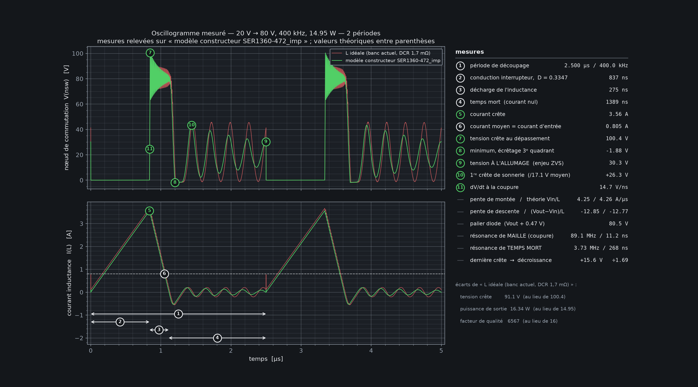
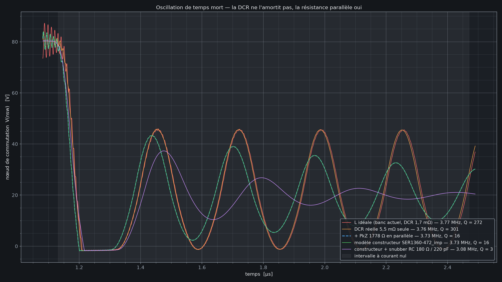
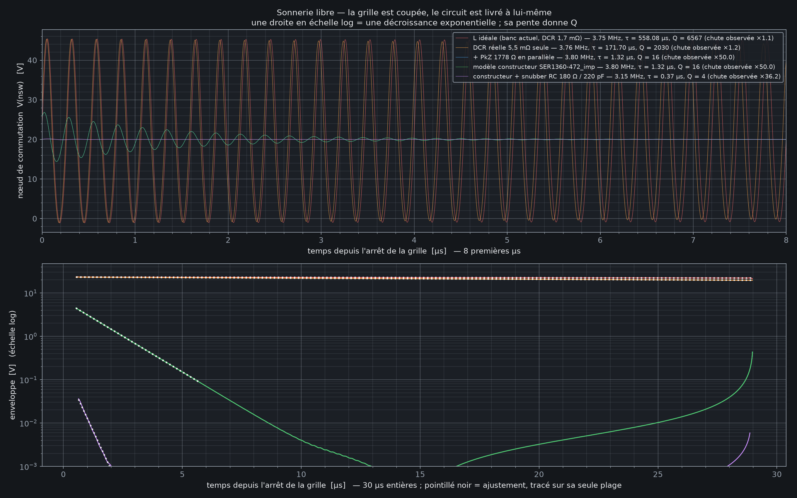
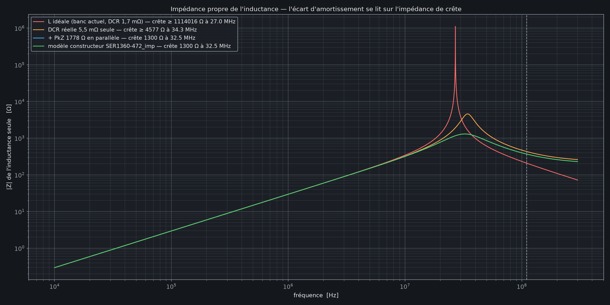
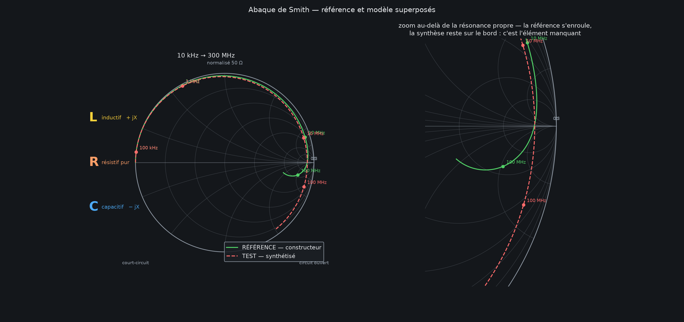
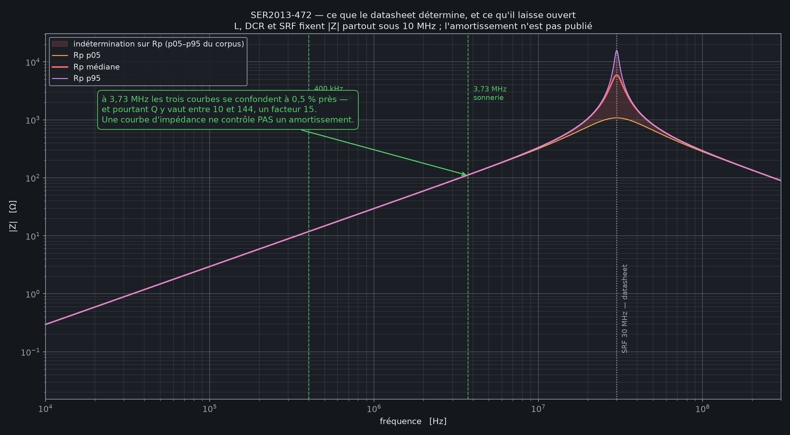

# Inductance du premier étage — caractérisation et choix

Premier étage boost d'un convertisseur à deux étages 20 V → 500 V. La
régulation pilote les deux étages depuis le même C2000, ce qui rend la
tension intermédiaire **libre** : l'étage 1 absorbe la variation d'entrée,
l'étage 2 celle de sortie.

Les pertes magnétiques y pèsent autant que tout le silicium réuni, et c'est
sur elles que les deux architectures se départagent. Elles sont donc
établies sur des données constructeur, pas sur une loi de manuel.

**Ordre de priorité : EMI, puis pertes, puis volume, puis prix.**

> **État : l'architecture DCM est retenue** (§9). L'hypothèse CCM est fermée
> sur la base des simulations par éléments, avec une réserve explicite —
> elle sera rouverte au moment des simulations EMI, seul domaine où elle
> gardait un avantage chiffré. Le présent chapitre conserve sa
> caractérisation, qui reste valide.

## 1. Contraintes

| grandeur | valeur |
|---|---|
| tension d'entrée | **12 à 25 V** |
| tension intermédiaire | 80 V (libre de 20 à 100 V, voir §6) |
| puissance | 5 à 50 W, **plafonnée à 25 W si V_in < 19 V** |
| fréquence | 400 kHz |

La tension d'entrée variable est la contrainte structurante, parce que le
seuil DCM/CCM va en **V_in²** :

$$\Large P_{seuil} = \frac{V_{in}^2\left(1 - V_{in}/V_{inter}\right)}{2 f_{sw} L}$$

Sur 12–25 V, ce seuil se déplace d'un facteur 3,5 à inductance fixe. Un
dimensionnement mené à tension d'entrée nominale ne tient pas aux extrêmes.

Les deux contraintes qui en découlent, chacune mordant à un bout opposé de
la plage d'entrée :

| architecture | condition | contrainte | cas dimensionnant |
|---|---|---|---|
| **1 — DCM partout** | P_seuil ≥ P_max(V_in) pour tout V_in | **L ≤ 6,12 µH** | V_in = 12 V, 25 W |
| **2 — CCM partout** | P_seuil ≤ 5 W pour tout V_in | **L ≥ 107,4 µH** | V_in = 25 V |

Le déclassement à 25 W sous 19 V double la limite DCM — sans lui elle
tomberait à 3,06 µH.

**Noter que les deux contraintes mordent à des bouts opposés de la plage.**
La tenue du mode se joue à **12 V / 25 W**, la thermique à **19 V / 50 W**,
où le courant crête atteint 6,3 A. Dimensionner sur un seul des deux donne
une réponse fausse, et c'est ce qui a d'abord fait retenir une pièce
thermiquement intenable (§3).

### Contrainte thermique — ajoutée après coup

Elle manquait aux premières versions de ce chapitre, qui ne regardaient que
les pertes en milliwatts. **Une même perte ne produit pas la même
température selon le volume du composant** : à 844 mW la SER1360-472 est à
95 °C, soit 70 K d'échauffement. Dans un boîtier à 50-60 °C ambiant la
pièce atteint sa limite de 125 °C. Le critère retenu est donc
**l'échauffement, pas la perte** — et il départage des pièces que les
milliwatts seuls déclarent équivalentes.

## 2. Méthode de caractérisation

Aucun datasheet ne publie de coefficients de Steinmetz. Le seul accès aux
pertes fer est le simulateur du fabricant, qui renvoie une perte **totale**.
Le modèle est donc extrait en retranchant le cuivre, puis ajusté par
moindres carrés sur les logarithmes :

$$\Large P_{fer} = k \cdot f_{sw}^{\,a} \cdot \Delta I^{\,b}$$

Le cuivre se calcule du courant efficace **du régime considéré** — et c'est
le piège principal. L'outil raisonne en CCM
($I_{rms}^2 = I_{DC}^2 + \Delta I^2/12$) alors qu'en DCM le courant est une
impulsion triangulaire avec temps mort, pour laquelle
$I_{rms}^2 = 2 I_{pk} I_{DC}/3$. Appliquer la mauvaise formule se trompe
d'un facteur deux. La formule DCM a été vérifiée contre la simulation SPICE
à 20 W : écart 1,1 %.

Trois contrôles avant usage de chaque jeu :

- **cohérence interne** — les deux balayages partagent un point ;
- **plausibilité des exposants** — b doit valoir ~2, a rester dans 1,0–1,9 ;
- **validation croisée par le DCR** — l'ajustement restitue la perte
  cuivre, donc le DCR, publié par ailleurs. C'est le contrôle le plus
  exigeant : il porte sur une grandeur que la méthode n'a jamais vue.

Ce dernier contrôle a réussi d'emblée — DCR déduits à **0,1 à 3,8 %** des
publiés sur quatre pièces.

> **Errances écartées.** Cinq exports successifs ont été nécessaires. Les
> défauts rencontrés — tableaux non rafraîchis, champs « ondulation » et
> « volt-temps » divergents, en-tête annonçant 5 A pour un balayage à 3 A,
> fichiers « CCM » contenant les pièces du DCM, composant sélectionné
> automatiquement hors sujet — ont tous été attrapés par les recoupements
> ci-dessus. Le plus coûteux aurait fait sortir des exposants de 0,14 et
> 1,32, physiquement absurdes. Ils ne subsistent pas dans les résultats
> ci-dessous et n'ont pas à encombrer le raisonnement ; le détail est dans
> l'historique git.

## 3. Pièces caractérisées

Coefficients pour $P_{fer}$ en mW, $f_{sw}$ en Hz, $\Delta I$ en A. Pertes
évaluées au point 50 W, V_in = 20 V.

### Candidates DCM — L ≤ 6,12 µH

| pièce | L | DCR | I_sat | k | a | b | résidu | ΔI mesuré | pertes 50 W | marge DCM |
|---|---|---|---|---|---|---|---|---|---|---|
| SER2211-302 | 3,0 µH | 1,1 mΩ | 27,5 A | 1,831e−7 | 1,381 | 2,167 | 10,9 % | 0,5–5,0 A | 902 mW | +104 % |
| **SER1360-472** | **4,7 µH** | 5,5 mΩ | 12,0 A | 5,026e−6 | 1,172 | 2,036 | **4,8 %** | **0,5–8,0 A** | **849 mW** | **+30 %** |
| SER2211-532 | 5,3 µH | 1,6 mΩ | 19,0 A | 1,488e−6 | 1,280 | 2,047 | 11,7 % | 0,5–5,0 A | 868 mW | +15 % |
| SER1360-602 | 6,0 µH | 5,5 mΩ | 9,5 A | 8,876e−6 | 1,151 | 2,004 | 3,8 % | 0,5–8,0 A | 833 mW | **+2 %** |
| SER1360-802 | 8,0 µH | 9,8 mΩ | 9,0 A | 1,021e−5 | 1,163 | 1,993 | 3,7 % | 0,5–8,0 A | — | **échec** |

« Marge DCM » = écart du seuil à la puissance maximale au cas dimensionnant
(V_in = 12 V, 25 W). Le 8 µH ne tient pas le mode ; le 6 µH le tient à 2 %
près, ce qui est trop serré pour une tolérance de composant.

Les trois SER1360 sont **entièrement mesurées** à leur point d'emploi.
Les deux SER2211 extrapolent de 19 à 58 % au-delà de leur dernier point et
portent 11 % de résidu : l'outil a tronqué leur domaine en ondulation. Elles
ne sont pas départageables des SER1360 sur ces données.

### Seconde campagne — à 4,7 µH fixe, le critère devient thermique

L'inductance étant verrouillée à 4,7 µH par la tenue du mode, toutes les
candidates partagent **la même marge DCM de 30 %**. Elles ne se départagent
plus que par l'échauffement et le comportement HF. Balayages refaits au
point réel, **1,0 à 6,3 A d'ondulation — sans extrapolation cette fois** :

| pièce | DCR | I_sat | k | a | b | résidu | fer | cuivre | **total** | **T** | f_rés | volume |
|---|---|---|---|---|---|---|---|---|---|---|---|---|
| SER2915H-472 | 1,9 mΩ | 50,1 A | — | — | — | — | — | — | **519 mW** | **37 °C** | ? | 12,0 cm³ |
| SER2915L-472 | 1,5 mΩ | 39,0 A | 2,567e−7 | 1,357 | 2,181 | 7,2 % | 523 mW | 15 mW | **538 mW** | **41 °C** | ? | 12,0 cm³ |
| **SER2013-472** | **1,7 mΩ** | 18,0 A | 1,038e−5 | 1,111 | 2,084 | **1,8 %** | 792 mW | 17 mW | **809 mW** | **46 °C** | **27,1 MHz** | **5,0 cm³** |
| SER1360-472 | 5,5 mΩ | 12,0 A | 5,026e−6 | 1,172 | 2,036 | 4,8 % | 789 mW | 55 mW | 844 mW | **95 °C** | 33,9 MHz | 1,0 cm³ |

Les fréquences de résonance propre sont **mesurées** par balayage `.ac` sur
les modèles à éléments localisés Coilcraft (doc 267-28), et concordent à
0,4 % avec $1/2\pi\sqrt{LC}$. Au-delà, l'inductance devient capacitive :
elle ne filtre plus, elle transmet. C'est la grandeur qui gouverne l'EMI
conduite haute fréquence, et **elle n'est publiée que pour les familles
SER13xx et SER20xx** — pas pour les SER29xx.

> **Réserve de données.** Le balayage en fréquence des SER29xx/SER2013
> montre un décrochage net entre 500 et 560 kHz : les pas de perte passent
> de ~75 à ~208 mW d'un coup, sur les deux pièces. Cela ressemble à un
> changement de régime de calcul chez Coilcraft plutôt qu'à de la physique.
> Sans effet à 400 kHz, mais à ne pas franchir sans vérification.

### Candidates CCM — L ≥ 107,4 µH visés

| pièce | L réelle | DCR | I_sat | cuivre | fer | **pertes 50 W** | seuil CCM pire cas |
|---|---|---|---|---|---|---|---|
| SER2211-473 | 47 µH | 8,9 mΩ | 5,6 A | 59 mW | 128 mW | **187 mW** | 11,4 W |
| WE-HCF 100 µH | 104,8 µH | 35,9 mΩ | 7,5 A | 239 mW | 13 mW | **252 mW** | **5,1 W** |

Aucune n'atteint les 107,4 µH ; la Würth en est à 2,4 %. Son modèle SPICE
donne 104,807 µH et 35,9 mΩ, valeurs confirmées par le calculateur du
fabricant (243 mW de cuivre à 2,60 A → 35,9 mΩ exactement).

**Le partage des pertes s'inverse entre les deux**, et c'est ce qui explique
tout le reste :

| | cuivre | fer |
|---|---|---|
| SER2211-473 | 32 % | **68 %** |
| WE-HCF 100 µH | **95 %** | 5 % |

Gros noyau peu bobiné d'un côté — DCR minuscule mais grande excursion de
flux dans beaucoup de matériau ; petit noyau serré de l'autre — quatre fois
le DCR, mais une ondulation deux fois plus faible dans un volume moindre.

## 4. Le résultat qui gouverne l'architecture 1

En DCM, l'énergie stockée par cycle est **imposée par la puissance**, pas
par l'inductance :

$$\Large \tfrac{1}{2} L I_{pk}^2 = \frac{P_{out}\left(1 - V_{in}/V_{inter}\right)}{f_{sw}} = 93{,}8\ \mu J \ \text{à 50 W}$$

donc $L I_{pk}^2$ est constant. En injectant $B = L I_{pk}/(N A)$ et
$L = \mu_{eff} N^2 A / l_e$ dans $P_{fer} \propto V_{noyau} B^2$ :

$$\Large P_{fer} \propto l_e \cdot \frac{L^2 I_{pk}^2}{N^2 A} = \mu_{eff} \cdot L I_{pk}^2$$

**La section, la longueur magnétique et le nombre de spires s'éliminent
tous.** Il ne reste que **la perméabilité du matériau** et l'énergie stockée.

### Portée réelle de ce résultat — correction

La première rédaction de ce chapitre en concluait qu'*« aucun choix de
composant ne sort l'architecture 1 de ce plancher »*, sur la foi de cinq
pièces tenant dans 2,3 %. **Cette conclusion est fausse, et la seconde
campagne la contredit directement :**

| pièce (toutes 4,7 µH) | pertes **fer** |
|---|---|
| SER1360-472 | 789 mW |
| SER2013-472 | 792 mW |
| **SER2915L-472** | **523 mW** |

Les deux premières sont à **0,4 % l'une de l'autre** — l'invariance est
réelle et spectaculaire entre elles, sur des volumes pourtant dans un
rapport 5. Mais la SER2915L fait **34 % de moins à énergie stockée
identique**.

La démonstration ci-dessus n'est pas en défaut : son hypothèse l'est.
$P_{fer} \propto \mu_{eff} \cdot L I_{pk}^2$ n'élimine la géométrie
**qu'à matériau donné**. Les cinq pièces de la première campagne
partageaient le même matériau de noyau ; la SER2915 n'en relève pas. Le
résultat correct est donc :

> **À matériau de noyau donné**, les pertes fer en DCM sont fixées par la
> puissance et hors d'atteinte de la géométrie. **Changer de matériau reste
> un levier**, et c'est le seul.

C'est une différence de nature : le premier énoncé fermait la question, le
second indique où chercher. Les 266 mW que la SER2915L fait gagner valent
0,55 point de rendement — ce n'est pas un plancher, c'est un choix.

## 5. Comportement en transition de mode

Un point de fonctionnement qui oscille entre les deux modes est la
préoccupation EMI principale. Pendant le temps mort du DCM, le nœud de
commutation résonne :

$$\Large v(t) = V_{in} + (V_{inter}-V_{in})\cos\!\left(\frac{2\pi t}{T_{res}}\right)$$

L'excursion après un temps mort $t_m$ vaut
$(V_{inter}-V_{in})\left[1-\cos(2\pi t_m/T_{res})\right]$, et
$t_m/T = 1-\sqrt{P/P_{seuil}}$. Près du seuil $t_m$ croît linéairement et
le cosinus rend l'excursion **quadratique** : l'amorce est progressive, pas
brutale.

Sa raideur dépend de l'inductance, et dans le sens favorable aux fortes
valeurs :

| L | f résonance | P/P_seuil pour une excursion pleine |
|---|---|---|
| 4,7 µH | 7,00 MHz | **94 %** |
| 47 µH | 2,21 MHz | 83 % |
| 104,8 µH | 1,48 MHz | **75 %** |

Avec 4,7 µH, 6 % sous le seuil suffisent à développer la résonance entière.
Avec 104,8 µH il faut 25 %, soit quatre fois plus de marge : la régulation
peut chasser autour du point sans que le spectre bascule.

Deux points à ne pas confondre :

- **L'amplitude ne dépend pas de la puissance.** Elle vaut
  $2(V_{inter}-V_{in}) = 120$ V crête-à-crête, fixée par les tensions
  seules. Ce que la puissance déplace, c'est seulement *où* tombe le seuil.
- **La forte inductance déplace la raie vers le bas** — 1,48 MHz contre
  7 MHz. La transition est plus douce mais ce qui apparaît tombe plus bas
  dans la bande conduite (150 kHz–30 MHz), où le filtrage est plus coûteux.

## 6. Tension intermédiaire

Libre de 20 à 100 V. L'équilibrage des rapports de conversion (moyenne
géométrique, qui minimise les extrêmes de rapport cyclique) place l'optimum
entre 77 et 100 V selon le cas ; **80 V y tombe au centre**.

Baisser V_inter réduirait les pertes fer de l'étage 1, puisque
$E \propto (1 - V_{in}/V_{inter})$ — 33 % de moins à 40 V. Mais le rapport
cyclique de l'étage 2 passerait alors à 0,92, régime où ses pertes de
conduction explosent. **Arbitrage non tranché** : il demande de modéliser
l'étage 2, hors périmètre de ce chapitre.

## 7. Choix

### Architecture 1 — DCM : **SER2013-472**, 4,7 µH

Le choix se fait en deux temps, et le premier reste inchangé : **4,7 µH**
est la seule valeur qui tienne le mode au cas dimensionnant 12 V / 25 W
(30 % de marge, contre 2 % pour le 6 µH et un échec pour le 8 µH).

À 4,7 µH fixe, les trois candidates se départagent ainsi :

| | pertes | échauffement | f_rés | volume | modèle SPICE |
|---|---|---|---|---|---|
| SER2915L-472 | **538 mW** | 41 °C | ? | 12,0 cm³ | **non publié** |
| **SER2013-472** | 809 mW | **46 °C** | **27,1 MHz** | **5,0 cm³** | **oui** |
| SER1360-472 | 844 mW | **95 °C** | 33,9 MHz | 1,0 cm³ | oui |

**La SER1360-472, retenue dans la première version de ce chapitre, est
écartée sur la thermique** : 70 K d'échauffement ne laissent aucune réserve
en ambiant réaliste. Le critère n'avait pas été appliqué.

**Retenu : SER2013-472.** La SER2915L fait 271 mW de moins — 0,56 point —
mais pour 2,4 fois le volume *et*, plus gênant au regard de l'ordre de
priorité, **sans modèle SPICE publié** : sa résonance propre est inconnue,
donc son comportement EMI haute fréquence n'est pas chiffrable. Avec un
bobinage de 12 cm³ contre 5, elle résonne nécessairement plus bas que
27 MHz, c'est-à-dire plus profondément dans la bande conduite.

L'arbitrage n'est donc pas « 0,56 point contre du volume » mais **pertes
contre EMI, deux critères de signes opposés** — et l'EMI passe avant. La
SER2013 l'emporte aussi parce qu'elle fait très bien le travail aux faibles
puissances, où le convertisseur passe l'essentiel de son temps : son écart
de pertes ne se manifeste qu'au voisinage de 50 W.

> À rouvrir si le document SPICE de la famille SER2900 devient disponible :
> si sa résonance propre s'avérait acceptable, les 271 mW redeviendraient
> décisifs.

Les deux SER2211 restent écartées faute de données exploitables dans leur
domaine d'emploi, non sur un jugement de performance.

### Architecture 2 — CCM : WE-HCF 100 µH (74437429203101)

| | SER2211-473 | WE-HCF 100 µH |
|---|---|---|
| pertes à 50 W | **187 mW** | 252 mW |
| zone DCM résiduelle | 5 → **11,4 W** | 5 → **5,1 W** |
| transition — excursion pleine à | 83 % du seuil | **75 %** |
| f résonance | 2,21 MHz | 1,48 MHz |

**Retenu : WE-HCF 100 µH.** Le surcoût est de 65 mW, soit **0,13 point de
rendement à 50 W**, en échange de la quasi-disparition de la transition de
mode : la zone DCM résiduelle passe de 6,4 W de large à 0,1 W, donc hors
de la plage utile. La contrainte EMI étant posée comme prioritaire, et un
point de fonctionnement chassant autour du seuil étant précisément le cas
redouté, cet échange est favorable.

Réserve assumée : sa résonance à 1,48 MHz est plus basse dans la bande
conduite que celle du SER2211-473. Si le filtre d'entrée s'avère
dimensionnant, l'arbitrage mérite d'être rouvert.

## 9. Arbitrage d'architecture — DCM retenu

Les deux architectures ont été simulées **sur le même banc** : même tension
d'entrée (19 V, le point dimensionnant), même diode, même température, même
inductance de maille, bilan par éléments dissipatifs, et convergence
vérifiée en divisant le pas de temps par deux (0,02 % et 0,05 %).

| poste, à ~48 W | **archi 1 — DCM** | archi 2 — CCM |
|---|---|---|
| transistor | **151 mW** (GaN EPC2207) | 622 mW (BSC360N15NS3) |
| diode V8PA22 | **470 mW** | 763 mW *(dont 244 d'avalanche)* |
| cuivre inductance | **18 mW** | 253 mW |
| grille | **6 mW** | 53 mW |
| fer (hors SPICE) | 792 mW | **17 mW** |
| **total** | **1438 mW** | 1708 mW |
| **rendement** | **97,06 %** | 96,60 % |
| **tension inverse diode** | **−99 V** | **−221 V, écrêtée** |

### Ce qui a décidé

**L'avalanche de la diode en CCM.** Le modèle constructeur de la V8PA22
donne 385 V de résonance inverse sans écrêtage, et son claquage réel à
220 V l'y plaque **400 000 fois par seconde** pour 244 mW. Ce n'est pas
qu'une perte : c'est un écrêtage non linéaire, donc une source large bande,
et un régime qu'on n'impose pas à une Schottky en continu. **Aucune pièce
du catalogue ne le résout — il n'existe pas de Schottky au-dessus de
200 V.**

Le mécanisme est structurel, pas accidentel : en CCM la diode est coupée en
pleine conduction, et sa charge se déverse dans l'inductance de maille. En
DCM le courant est **déjà nul** à l'amorçage du transistor — il n'y a rien
à évacuer, rien à faire résonner. L'archi 1 mesure 99 V, insensible au
calibre (résultat identique avec BV = 220 et 400 V).

**Et l'argument qui portait le CCM est tombé.** Il reposait sur la largeur
de la zone de bascule de mode (§5). Les neuf points d'exploitation simulés
montrent l'archi 1 **en DCM sur toute la plage** 12–25 V / 5–50 W : il n'y
a pas de transition à redouter.

### Ce qu'on abandonne, et c'est sur la priorité n°1

Le CCM gardait un avantage réel et chiffré sur le **spectre d'ondulation** :
facteur 18 sur l'ondulation du courant d'entrée, et rapport crête/moyen de
4,5 en sortie contre 10,8. Le DCM tire des impulsions triangulaires de 0 à
6,3 A là où le CCM tire un courant quasi continu. **Cela se paiera en filtre
d'entrée.**

Le jugement posé est qu'**on troque un problème filtrable contre un
problème qui ne l'est pas** : les harmoniques de 400 kHz se traitent par un
filtre dimensionnable, une résonance à 168 MHz et un écrêtage par avalanche
rayonnent et se traitent mal. Mais il faut être clair : **le spectre conduit
n'a été simulé pour aucune des deux.** La fermeture du CCM sur la priorité
EMI repose donc sur un raisonnement, pas sur une mesure.

> **Réserve ouverte.** L'hypothèse CCM est fermée *provisoirement*. Elle
> sera rouverte lors des simulations EMI, où son avantage d'ondulation sera
> enfin chiffrable face au coût du filtre d'entrée du DCM.

## 8. Portée et réserves

**Facteur 4,5 entre les deux architectures sur le seul poste magnétique**
(849 contre 187 mW à 50 W), et il est structurel : le §4 démontre qu'aucun
choix de composant ne le réduit en DCM.

1. **L'outil Coilcraft suppose du CCM** — *« waveform and AC loss
   calculations assume 50 % duty cycle in continuous conduction mode »*. En
   DCM le noyau reste au repos pendant le temps mort. À ΔI et fréquence
   égaux l'excursion de flux est la même, donc l'ordre de grandeur tient,
   mais le contenu harmonique diffère et une loi de Steinmetz classique ne
   le rend pas. Le calculateur Würth, lui, demande le rapport cyclique et
   ne souffre pas de cette limite.
2. **Les deux SER2211 de l'architecture 1 restent extrapolées** (§3).
3. **Tout est à 25 °C.** Les pertes fer d'une ferrite varient notablement
   sur la plage de fonctionnement, et aucun de ces modèles ne porte de
   dépendance en température.
4. **Les oscillogrammes sont approximatifs, et on sait pourquoi.** Lecture
   d'expérience sur les formes d'onde du §9 : trois phases se distinguent —
   transistor fermé sans oscillation, décharge de l'inductance avec une
   sonnerie haute fréquence amortie, puis à courant nul une **oscillation
   basse fréquence qui ne s'amortit pas**. Cette dernière est un défaut du
   modèle, pas du circuit — **confirmé par simulation**, voir §10.
   Correctif traité en étape A du [chapitre 4](../04-emi/plan.md).
5. **L'analyse de transition du §5 est analytique**, avec une résonance non
   amortie et un C constant, alors que le C_oss du GaN est fortement non
   linéaire. À confirmer en transitoire.

## 10. Amortissement du temps mort — mesuré

Levée de la réserve 4 du §8. Banc : `02-mosfet-diode/test_amortissement.py`,
un seul point (20 V → 80 V, 400 kHz, D = 0,3347, 15 W), cinq variantes
d'inductance et **rien d'autre qui change**. Figures dans
`02-mosfet-diode/illustrations/amortissement/`.

### Ce que l'oscillogramme montrait

Trois phases, conformes à la lecture d'expérience : transistor fermé sans
oscillation ; transistor ouvert, décharge avec une salve amortie à
**88–89 MHz** (inductance de maille contre $C_{oss}$ et $C_j$) ; puis à
courant nul une oscillation à **3,73 MHz** (inductance principale contre les
mêmes capacités). Les deux diffèrent d'un facteur 24 : **ce sont deux
circuits, pas deux harmoniques du même.**

Les grandeurs sont **relevées sur la trace**, pas recopiées d'une formule :
pentes ajustées sur les rampes, palier pris en médiane sur l'intervalle de
conduction de la diode, amplitudes de sonnerie issues d'une détection de
crêtes. Les pentes mesurées — 4,25 et −12,85 A/µs — valident les 4,26 et
−12,77 attendus, l'écart sur la descente étant la chute de la diode, absente
de la formule.

Deux chiffres à retenir pour le [chapitre 4](../04-emi/plan.md) : la tension
**à l'allumage vaut 30,3 V**, il n'y a donc pas de commutation à zéro de
tension ; et le **dV/dt à la coupure atteint 14,7 V/ns**, qui est la source
du mode commun.

Le tireté bleu — « DCR réelle + PkZ seule » — se superpose *exactement* au
modèle constructeur en vert. C'est la preuve visuelle du point 1 ci-dessous.

### Facteur de qualité, mesuré par sonnerie libre

L'excitation est coupée (`Ncycles` de `PULSE`) et le circuit sonne 30 µs.

| variante | τ | **Q** | chute observée |
|---|---|---|---|
| L idéale, DCR 1,7 mΩ *(banc actuel)* | 558 µs | **6 567** | ×1,1 — extrapolé |
| DCR **réelle** 5,5 mΩ, ×3 | 172 µs | **2 030** | ×1,2 — extrapolé |
| + **PkZ 1778 Ω en parallèle** | 1,32 µs | **16** | ×50 |
| modèle constructeur SER1360-472_imp | **1,32 µs** | **16** | ×50 |
| + snubber RC 180 Ω / 220 pF | 0,37 µs | 4 | ×36 |

En échelle logarithmique, une droite est une exponentielle et sa pente donne
Q. Le pointillé blanc n'est tracé que sur sa plage d'ajustement. La colonne
« chute observée » du tableau est la garde-fou : à ×1,1, le τ annoncé est
une extrapolation et non une mesure.

Trois résultats, dont deux n'étaient pas prévus :

1. **Tripler la résistance série ne change rien.** La DCR n'est pas le
   mécanisme. Les lignes 3 et 4 sont **identiques au chiffre près** : tout
   l'amortissement tient à la seule résistance parallèle.
2. τ passe de 220 périodes de découpage à **1,32 µs, soit moins que le temps
   mort** (1,4 µs). L'oscillation s'éteint dans la période.
3. **Un snubber RC coûterait 509 mW** — 35 % du budget de pertes total
   (1 438 mW). Il est inutile : le composant réel s'amortit tout seul.

### Effet au-delà de l'allure de la courbe

À rapport cyclique **identique**, la puissance de sortie passe de 16,34 W
(idéale) à 14,95 W (constructeur) : **9 % d'écart**. L'artefact ne faussait
pas que l'esthétique.

### Correction d'un chiffre publié

La réserve 4 annonçait *Q ≈ 100 000 contre 4,3, facteur 20 000*. C'était une
estimation de tête à partir du seul DCR. **Le rapport mesuré est de 400**
(6 567 → 16) : le GaN, la diode et leurs résistances d'accès dissipent aussi.
La conclusion tient, l'ordre de grandeur non.

### Et le modèle de la SER2013-472 n'existe pas

**Coilcraft ne publie aucun modèle SPICE pour la SER2013-472** — la famille
s'arrête à 2,0 µH (`SER20XX.lib` : -681, -801, -901, -102, -122, -202). Le
fichier utilisé jusqu'ici était une reconstruction faite à la main, dont
seule la DCR venait du catalogue.

La cause en une courbe — et le moyen de démasquer un modèle fabriqué. Le
modèle discret culmine à plus de 1,1 MΩ à sa résonance ; le balayage, même
à 3 000 points par décade, n'en touche pas le sommet. Le modèle constructeur
culmine à 1 300 Ω. **Aucun composant de puissance réel ne dépasse quelques
kΩ à sa résonance propre** : au-delà, c'est le modèle qui parle.

Deux conséquences sur les tableaux §3 et §7 :

- la colonne **« modèle SPICE publié : oui »** de la SER2013-472 est
  **fausse** — elle est dans le même cas que la SER2915, écartée pour ce
  motif ;
- la **résonance propre de 27,1 MHz** qui lui est attribuée sort de ce
  fichier reconstruit. Elle n'est pas opposable — et elle est fausse : **le
  datasheet annonce 30 MHz typ**, soit 10 % au-dessus. La capacité propre
  inventée (7,40 pF) dépasse de 24 % celle que L et la SRF imposent
  (5,99 pF). Voir §11.

> **Correction d'une affirmation de ce chapitre.** J'ai d'abord écrit que le
> datasheet de la SER2013-472 ne publiait pas de résonance propre. C'est
> faux : je l'avais conclu d'un export CSV du *Power Inductor Finder*, qui
> ne porte pas cette colonne, sans ouvrir le PDF. **Conclure d'une source
> incomplète** — la même faute que celle qui avait produit le fichier
> reconstruit.

Le banc ci-dessus utilise donc la **SER1360-472**, seul 4,7 µH de la gamme
SER modélisé, comme **substitut documenté pour la question de
l'amortissement** — les deux familles partagent le matériau de noyau (§4).
Le choix de composant du §7 reposait sur la thermique et le volume, qui
restent valides ; **l'argument « modèle disponible » doit en être retiré.**

## 11. Banc d'impédance — contrôler un modèle avant de s'en servir

Suite directe du §10. Banc :
`02-mosfet-diode/impedance_banc.py` et `run_impedance_blanc.py`, figures dans
`02-mosfet-diode/illustrations/impedance/`.

### La synthèse en forme fermée

Würth et Coilcraft convergent sur la même topologie — $R_p \parallel C_p
\parallel (R_s + L)$ — relevée sur **5 071 modèles** présents sur le disque.
Ses quatre paramètres se déduisent de quatre nombres de catalogue, sans
ajustement :

$$\Large R_s = \mathrm{DCR} \qquad C_p = \frac{1}{L\,(2\pi f_{SRF})^2} \qquad R_p = |Z|_{crête}$$

Validé sur la **SER1360-472**, seule 4,7 µH de la gamme ayant *à la fois* un
datasheet et un modèle constructeur — donc une vérité terrain :

| | écart |
|---|---|
| médian, 10 kHz – 100 MHz | **0,00 dB** |
| maximum sous la résonance propre | **0,09 dB** |
| maximum au-dessus | 1,71 dB |
| aller-retour `.lib` ↔ forme fermée | **0,001 dB** |

### L'abaque de Smith voit ce que le module laisse passer

Référence et modèle **superposés**, jamais juxtaposés. Au-delà de la
résonance propre la référence **s'enroule vers l'intérieur** — les pertes de
la résistance que Coilcraft place en série avec $C_p$, absente d'une
topologie à quatre éléments — alors que la synthèse reste collée au cercle
unité. Le même écart ne vaut que **1,7 dB** sur le tracé de module et y passe
inaperçu. Contre toute attente, c'est la vue la plus sensible.

### Ce que le datasheet détermine, et ce qu'il laisse ouvert

Le datasheet de la SER2013-472 publie **L, DCR et SRF** — trois paramètres
sur quatre. **L'impédance de crête n'y figure pas**, et c'est elle qui porte
l'amortissement. En l'encadrant par le corpus (1 078 – 15 844 Ω) :

| | indétermination |
|---|---|
| sur $|Z|$, sous 1 MHz | **0,00 dB** |
| sur $|Z|$, au sommet | 23,3 dB |
| sur **Q à 3,73 MHz** | **facteur 15** |

À 3,73 MHz — la fréquence de sonnerie du §10 — les courbes se confondent à
0,5 % près **et pourtant Q y est indéterminé d'un facteur 15**. Sous la
résonance, $|Z| \simeq \omega L$ quel que soit $R_p$ : la branche parallèle
n'y pèse rien.

> **Une courbe d'impédance ne contrôle pas un amortissement** — sauf si la
> référence monte jusqu'à la résonance propre. Un « conforme » obtenu sur
> une référence qui s'arrête au point de fonctionnement ne porte que sur $L$
> et $R_s$. C'est exactement la configuration dans laquelle le fichier
> reconstruit est passé.

### Conséquence pour le choix du §7

Un modèle SER2013-472 bâti sur son seul datasheet est **juste à 400 kHz** :
le bilan de pertes du §7 n'est pas menacé. Il est **muet sur la sonnerie** à
3,73 MHz, donc inutilisable tel quel pour le [chapitre 4](../04-emi/plan.md).
Lever cette réserve demande une mesure d'impédance de la pièce, ou le modèle
que Coilcraft ne publie pas.

## Reproduire

Données sources : `donnees/` — exports du *Power Inductor Finder* de
Coilcraft et du calculateur REDEXPERT de Würth. Modèle SPICE Würth :
`lib_spice_commun/WurthElektronik/ltspice-power-magnetics-v1/sub/WE-HCF.lib`.

Conditions des balayages Coilcraft : IDC 3 A, 25 °C, « Enter For Each Part ».

| balayage | ondulation | fréquence |
|---|---|---|
| DCM | 1,5 → 4,5 A puis 6,7 → 8 A | 400 kHz |
| DCM | 5,0 A | 100 → 1000 kHz |
| CCM | 0,47 → 1,4 A | 400 kHz |
| commun | 0,8 A | 100 → 1000 kHz |

Point Würth : 400 kHz, DC 0,75, I 2,60 A, ΔI 400 mA → AC 16,7 mW,
DC 243 mW, ΔT 5,33 K.

**Ne renseigner qu'un seul** des champs « Ripple Current » et « Volt Time »
chez Coilcraft : ils divergent silencieusement. Cliquer **Update** avant
tout export. Chez Würth, filtrer explicitement la référence — la sélection
automatique « Suitable » propose des pièces hors sujet.
