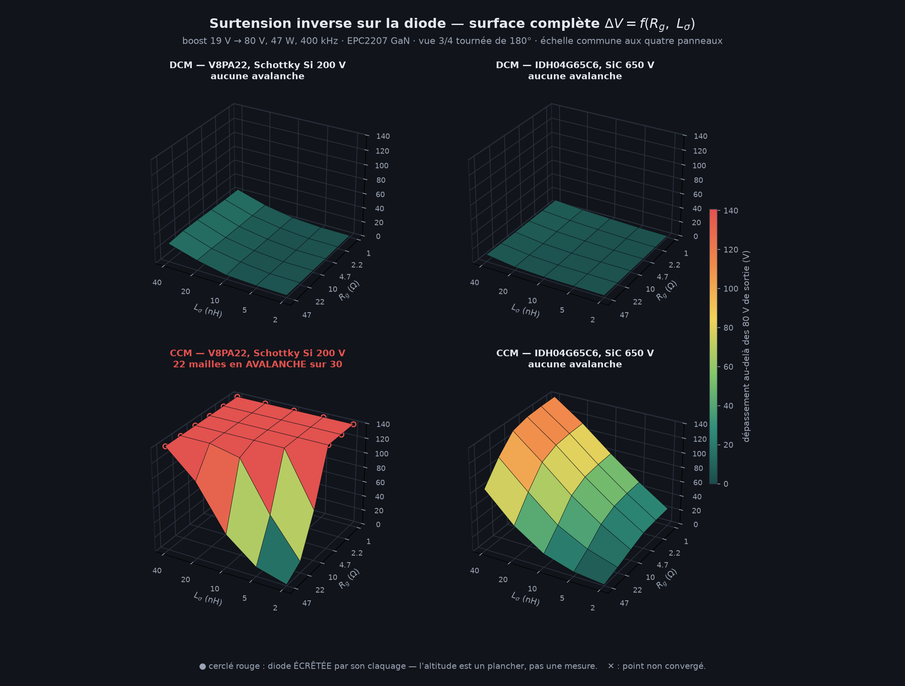
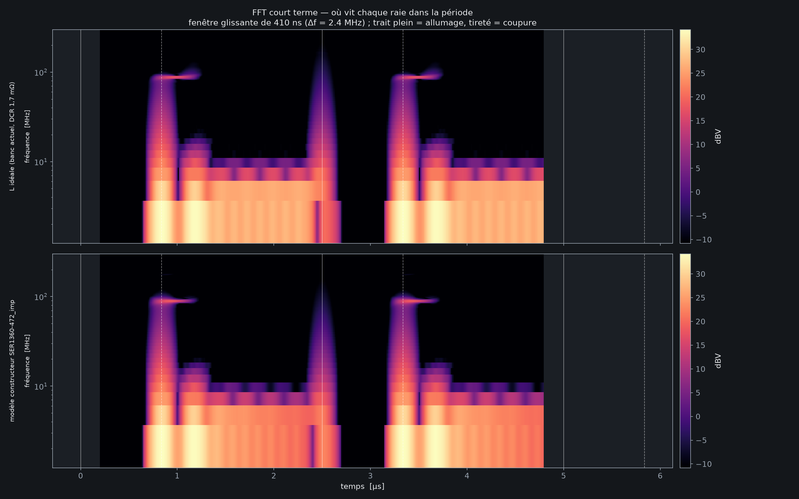
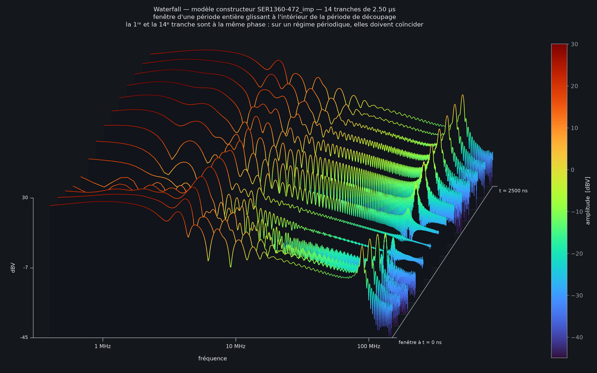

# EMI conduite — plan d'étude

Chapitre 4. Entrée : une architecture arrêtée au chapitre 3 et une
sélection de composants. Sortie visée : un spectre d'émission conduite
confronté à un gabarit, et un filtre d'entrée dimensionné.

**C'est la priorité n°1 du projet**, et c'est le poste le moins instruit :
les trois chapitres précédents n'ont produit aucune mesure spectrale.

> **Deux décisions prises le 2026-11-18** : gabarit **CISPR 25 embarqué**
> (§1), et **pas de mesure d'impédance** de l'inductance retenue — son
> amortissement sera balayé, et les spectres publiés en enveloppe (§3).

## 0. Point de départ

| | |
|---|---|
| architecture | **DCM**, 400 kHz, 12–25 V → 80 V, 5–50 W |
| transistor | GaN EPC2207, modèle constructeur |
| diode | Vishay V8PA22 200 V / 8 A, modèle constructeur |
| inductance | Coilcraft SER2013-472, 4,7 µH, modèle à éléments localisés doc 267 |
| rendement établi | 97,06 % à 47,4 W, bouclage 1,7 % |

Outillage existant : `02-mosfet-diode/run_emi_conducted.py` — LISN simplifié
plus FFT numpy, écrit pour une configuration **périmée** (NVD6824NL,
200 kHz, 47 µH, 40 W). La mécanique est réutilisable, les composants non.

## 1. Gabarit — TRANCHÉ : CISPR 25, embarqué

> **Décision du concepteur, 2026-11-18.** Le gabarit applicable est
> **CISPR 25**, usage embarqué. Bande **150 kHz – 108 MHz**, réseau
> stabilisateur **5 µH**. La réserve du script `run_emi_conducted.py`, qui
> comparait faute de mieux à un CISPR 32 classe B, est levée : ce script
> est à reprendre.

| | |
|---|---|
| bande mesurée | 150 kHz – 108 MHz |
| LISN | 5 µH |
| méthode | tension aux bornes du LISN |

C'est le choix le **plus sévère** des trois envisagés : la bande haute
s'étend 3,6 fois plus loin que celle de CISPR 32, et l'impédance du réseau
est dix fois plus faible.

### Ce que cette bande impose aux modèles

108 MHz, c'est **bien au-dessus de la résonance propre** de l'inductance
retenue (30 MHz) et de celle d'un MLCC de découplage (1,8 MHz). Dans cette
zone, aucun composant n'est plus ce que son étiquette annonce, et c'est le
modèle — pas le catalogue — qui parle. Deux conséquences chiffrées, du
[§11 du chapitre 3](../03-architectures/inductances.md) :

- le modèle Coilcraft d'inductance est déclaré valide **jusqu'à 110 MHz**,
  soit tout juste la bande — aucune marge ;
- un modèle d'inductance à quatre éléments s'écarte du modèle constructeur
  de **1,7 dB à 100 MHz**. Utiliser la variante à cinq éléments, ajustée.

### Les lignes de gabarit — OBTENUES, 2026-11-20

Source : note d'application Tekbox `AN_Conducted_Noise_Measurement_TekboxLISN_TBOH01`,
tables 1 et 2, méthode en tension. **Le document avertit lui-même que ses
tables sont « a simplified summary rather than an exact representation of the
corresponding CISPR 25 tables ».** Cet avertissement se transmet : ces valeurs
servent à cadrer une étude, pas à prononcer une conformité.

**Crête (P) et quasi-crête (QP), en dBµV**

| classe | 0,15–0,3 | | 0,53–1,8 | | 5,9–6,2 | | 26–41 | | 41–88 | | 88–108 | |
|---|---|---|---|---|---|---|---|---|---|---|---|---|
| | P | QP | P | QP | P | QP | P | QP | P | QP | P | QP |
| 1 | 110 | 97 | 86 | 73 | 77 | 64 | 68 | 55 | 58 | 49 | 62 | 49 |
| 2 | 100 | 87 | 78 | 65 | 71 | 58 | 62 | 49 | 52 | 43 | 56 | 43 |
| **3** | **90** | **77** | **70** | **57** | **65** | **52** | **56** | **43** | **46** | **37** | **50** | **37** |
| 4 | 80 | 67 | 62 | 49 | 59 | 46 | 50 | 37 | 40 | 31 | 44 | 31 |
| 5 | 70 | 57 | 54 | 41 | 53 | 40 | 44 | 31 | 34 | 25 | 38 | 25 |

**Moyenne (AV), en dBµV**

| classe | 0,15–0,3 | 0,53–1,8 | 5,9–6,2 | 26–41 | 41–88 | 88–108 |
|---|---|---|---|---|---|---|
| 1 | 90 | 66 | 57 | 48 | 42 | 42 |
| 2 | 80 | 58 | 51 | 42 | 36 | 36 |
| **3** | **70** | **50** | **45** | **36** | **30** | **30** |
| 4 | 60 | 42 | 39 | 30 | 24 | 24 |
| 5 | 50 | 34 | 33 | 24 | 28 ⚠ | 28 ⚠ |

> **⚠ Anomalie relevée dans la source, non corrigée ici.** La classe 5 est la
> plus sévère : chaque colonne décroît de la classe 1 à la classe 5. Les deux
> dernières cases rompent cette monotonie — 24 en classe 4, **28** en classe 5.
> Le corps du même document annonce par ailleurs « class 5, limit for average
> detection in the 68 MHz – 108 MHz range: **18 dBµV** ». La progression
> régulière de −6 dB par classe donne également 18. **La valeur 28 est donc
> très probablement une coquille pour 18**, mais je ne la corrige pas dans la
> table : on ne réécrit pas une source, on signale la contradiction et on
> s'abstient de conclure dans cette bande tant qu'elle n'est pas levée.

#### Ce que ces bandes changent à l'étude — à 400 kHz, il n'y a PAS de limite

Les limites CISPR 25 ne couvrent pas le spectre en continu : ce sont des
**bandes de service** radio, séparées par des trous. Conséquence directe sur
ce convertisseur, dont le découpage est à **400 kHz** :

| raie | fréquence | bande | limite classe 3 (AV) |
|---|---|---|---|
| fondamental | 400 kHz | **trou 0,3–0,53 MHz** | **aucune** |
| H2 | 800 kHz | 0,53–1,8 MHz | 50 dBµV |
| H3 | 1,2 MHz | 0,53–1,8 MHz | 50 dBµV |
| H4 | 1,6 MHz | 0,53–1,8 MHz | 50 dBµV |
| H5 | 2,0 MHz | trou 1,8–5,9 MHz | aucune |
| H15 | 6,0 MHz | 5,9–6,2 MHz | 45 dBµV |

> **Le fondamental tombe dans un trou du gabarit.** Les 88,7 dBµV mesurés à
> 400 kHz au premier spectre ne sont donc comparables à **aucune** limite
> CISPR 25. Ce qui contraint le filtre, ce sont **H2, H3 et H4 dans la bande
> moyennes ondes** — et accessoirement H15 dans une fenêtre de 300 kHz de
> large. Dimensionner sur le fondamental serait viser à côté.
>
> Cela ne veut pas dire que le fondamental est sans conséquence : il reste
> le terme dominant de l'ondulation et il alimente le rayonnement du câble.
> Mais il ne se juge pas contre CISPR 25.

**Classe à viser : non tranchée.** Les tables ci-dessus sont complètes pour
les cinq classes ; la classe 3 est mise en gras comme hypothèse de travail
par défaut, à confirmer. Chaque classe en moins coûte 6 à 10 dB.

### L'alternative CISPR 11 — écartée, et pourquoi

| | CISPR 25 | CISPR 11 / EN 55011 |
|---|---|---|
| domaine | véhicules, bateaux, moteurs | ISM : industriel, scientifique, médical |
| bande conduite | 150 kHz – **108 MHz** | 150 kHz – **30 MHz** |
| réseau | **5 µH** | **50 µH / 50 Ω** (V-AMN) |
| limites | par bande de service, 5 classes | continues, groupe 1/2 × classe A/B |

Limites CISPR 11 groupe 1, port réseau, en dBµV :

| bande | classe A — QP / AV | classe B — QP / AV |
|---|---|---|
| 150–500 kHz | 79 / 66 | 66 / 56 (en pente décroissante) |
| 0,5–5 MHz | 73 / 60 | 56 / 46 |
| 5–30 MHz | 73 / 60 | 60 / 50 |

Trois raisons de rester sur CISPR 25 :

1. **Le LISN déjà construit est le 5 µH de CISPR 25.** Passer à CISPR 11
   impose un réseau 50 µH/50 Ω — impédance de source tout autre, donc
   spectre tout autre. Ce n'est pas un changement de ligne sur un graphe.
2. CISPR 11 vise le **port réseau alternatif**. L'entrée ici est en 20 V
   continu ; les limites sur port d'alimentation continue existent dans les
   éditions récentes mais n'ont pas été obtenues.
3. CISPR 11 s'arrête à 30 MHz. CISPR 25 pousse à 108 MHz — **c'est le choix
   le plus sévère**, et celui déjà acté le 2026-11-18.

> En classe B, CISPR 11 serait contraignant **dès 150 kHz et sans trou** :
> le fondamental à 400 kHz y tomberait sous une limite de 56 dBµV en moyenne.
> Là où CISPR 25 l'ignore, CISPR 11 le sanctionne. Les deux gabarits ne
> pointent donc pas le même défaut, et aucun n'est « plus sévère » en tout
> point.

### Contrainte sur la diode — surface complète, 120 points

**Version interactive :** [`surtension-3d.html`](surtension-3d.html) —
surface tournante, trois grandeurs au choix (ΔV, dV/dt, di/dt), infobulle
par point.

$$\Large \Delta V = L_\sigma rac{di}{dt}$$

Vérifiée sans aucun paramètre libre : 20 nH × 3,65 A/ns = 72,9 V pour
72,9 V mesurés.

| coin | ΔV | verdict |
|---|---|---|
| DCM · Si · 22 Ω · 2 nH | 2,8 V | marge 137 V |
| CCM · Si · 10 Ω · 2 nH | 69,0 V | marge 71 V — **avalanche dès 5 nH** |
| CCM · Si · 22 Ω · 2 nH | 15,7 V | marge 124 V |
| CCM · SiC · 10 Ω · 2 nH | 15,1 V | marge **555 V** |

**En DCM les deux diodes sont plates à 2–3 V** sur toute la grille : le
courant est déjà nul à l'enclenchement. **En CCM la `V8PA22` est en
avalanche sur 22 mailles sur 30.** Le coin à 10 Ω est une arête — 3 nH de
dérive au routage suffisent à basculer.

<b>Paramètres</b> — <code>run_surface.py</code>

| | |
|---|---|
| étage | boost 19 V → 80 V, 47 W, 400 kHz |
| inductances | `SER1360-472` 4,7 µH (DCM) · `SER2211-473` 47 µH (CCM) |
| transistor | `EPC2207` GaN, modèle EPC |
| diodes | `V8PA22` Si 200 V · `IDH04G65C6` CoolSiC G6 650 V |
| entrée | 220 µF ∥ (1000 µF + 500 mΩ) ∥ 1 µF X7R |
| grille | $R_g$ 1→47 Ω × $L_\sigma$ 2→40 nH, **120 points, 0 manquant** |
| fenêtre | 8 + 2 périodes, pas max 0,5 ns — suffisant pour une **crête** |

> Les mailles cerclées de rouge sont **écrêtées** : la diode y est en
> avalanche, l'altitude est son claquage et non le pic réel.
>
> La SiC est l'**Infineon**, pas la Wolfspeed : cette dernière ne converge
> pas en DCM (cf. §12.6 du chapitre 3).

### Dettes de modèle — inscrites le 2026-11-20

Deux approximations du banc EMI, à ne pas laisser passer dans un résultat :

1. **Le condensateur d'entrée est provisoire.** `0805_885012107014_10uF`,
   quatre en parallèle, choisi pour faire tourner le banc avant que le choix
   des condensateurs ne soit instruit. Aucune étude ne l'a retenu.
2. **Il est en X5R, et non en X7R comme je l'avais supposé.** Décodage du
   numéro de pièce : `885012`·**1**·`07`·`014`, septième chiffre `1` = X5R.
   Le modèle SPICE **ne porte pas** la perte de capacité sous tension
   continue, et le X5R est la pire classe II sur ce point.

Conséquence chiffrée, par le [banc d'impédance](../../.claude/skills/impedance/SKILL.md#4-bis-le-derating-nest-pas-un-modèle--cest-une-valeur) :

| condition | C effective | \|Z\| à 400 kHz | à 2 MHz |
|---|---|---|---|
| nominal catalogue | 40 µF | 9,79 mΩ | 1,35 mΩ |
| température seule, ±15 % **normatif** | 34 µF | 11,5 mΩ (**+1,4 dB**) | 1,64 mΩ (+1,7 dB) |
| avec un DC bias **hypothétique** de 0,45 | 15,3 µF | 25,8 mΩ (+8,4 dB) | 4,34 mΩ (+10,2 dB) |

La deuxième ligne ne demande aucune hypothèse — elle découle du code
diélectrique, qui est normatif. **Le spectre conduit publié est donc
optimiste d'au moins 1,4 dB** à la fréquence de découpage. La troisième ligne
est une illustration d'ordre de grandeur : la tension nominale de la pièce
est inconnue, la bibliothèque n'en porte aucune.

### Réseau d'entrée — trois variantes mesurées, 2026-11-20

Banc `run_cin.py`, `Rp = 5903 Ω` (médiane du nuage), 16 périodes de mesure
après 24 d'établissement.

<b>Paramètres</b> — <code>run_cin.py</code>

| | |
|---|---|
| inductances | `SER1360-472` 4,7 µH DCM · `SER2211-473` 47 µH CCM |
| transistor / diode | `EPC2207` GaN · `V8PA22` Schottky Si 200 V |
| entrée | 220 µF ∥ (1000 µF + 500 mΩ) ∥ 1 µF X7R |
| LISN | CISPR 25, 5 µH, mesure en tension |
| **$R_g$ / front** | **1 Ω / 150 ps → 385 V/ns** ⚠ figure non reprise |
| fenêtre | 24 + 16 périodes, pas max 0,5 ns |

> ⚠ **Vitesse tranchée depuis le 2026-11-21 : $R_g = 10\ \Omega$, 73 V/ns**,
> déclarée avec sa justification dans [`../banc.toml`](../banc.toml). La
> figure ci-dessus a été relevée à 385 V/ns, valeur héritée et jamais
> choisie. **Son contenu HF reste à reprendre** ; le pic de 88 MHz est très
> probablement un artefact de cette vitesse.

| | C totale | ondulation d'entrée | état |
|---|---|---|---|
| `bulk` — 4 × 10 µF X5R | 40 µF | 0,092 V (0,5 %) | exploitable |
| `bulk_hf` — + 100 nF X7R + 1 nF C0G | 40,1 µF | 0,071 V (0,4 %) | exploitable |
| `hf` — 100 nF + 1 nF **seuls** | 0,101 µF | **60,9 V (320 %)** | rail détruit |

**Crête par bande, en dBµV, contre la classe 3 au détecteur moyenne**

| bande (MHz) | limite | `bulk` | `bulk_hf` | `hf` |
|---|---|---|---|---|
| 0,15–0,3 | 70 | 11,2 | 11,1 | 38,2 |
| **0,53–1,8** | **50** | **72,9** | **72,9** | 127,3 |
| 5,9–6,2 | 45 | 30,4 | 29,9 | 70,7 |
| 26–41 | 36 | 19,5 | 16,2 | 48,9 |
| **41–88** | **30** | **53,2** | **50,6** | 74,7 |
| **88–108** | **30** | **54,2** | **52,7** | 75,3 |

#### Trois conclusions

1. **Le réseau HF seul ne tient pas le rail — par RÉSONANCE, non par
   privation de charge.** Le nœud d'entrée est pris **entre deux
   inductances** : 5 µH du LISN côté réseau, 4,7 µH du boost côté
   convertisseur. `C_in` n'y voit donc pas une source, il voit un
   **résonateur** de $L_{//} = 2{,}42\ \mu$H.

   $$\Large f_0=\frac{1}{2\pi\sqrt{L_{//}C_{in}}}\qquad
   Q=\frac{1}{R}\sqrt{\frac{L_{//}}{C_{in}}}$$

   | C_in | $f_0$ | $f_0/f_{sw}$ | $Z_0$ | $Q$ |
   |---|---|---|---|---|
   | 40 µF | **16,2 kHz** | 0,04 | 0,25 Ω | ≈ 17 |
   | 101 nF | **321,7 kHz** | **0,80** | 4,90 Ω | **≈ 345** |

   Réduire la capacité **remonte la résonance jusque contre la fréquence de
   découpage**. Le contenu spectral de `V(nin)` le confirme : la raie
   dominante est à **400 kHz, 29,9 V d'amplitude** — l'excitation elle-même,
   amplifiée par un circuit bouchon quasi non amorti, et non une oscillation
   libre à 321 kHz. L'impédance du bouchon à 400 kHz passe de 0,01 Ω à
   11,1 Ω, soit **+61 dB**.

   > **CORRECTION — j'avais annoncé un mauvais mécanisme.** J'avais attribué
   > l'effondrement à un bilan de charge : 1,19 µC à fournir pendant les
   > 466 ns de temps mort, d'où 11,8 V d'ondulation sur 101 nF. **C'était la
   > mauvaise physique**, et le chiffre comme le raisonnement sont à jeter.
   > L'inductance d'entrée ne laisse pas le condensateur se vider seul : elle
   > forme un bouchon avec lui. Un régime établi à 60,9 V crête-à-crête,
   > identique sur huit fenêtres successives et à courant moyen stable,
   > n'est pas une famine — c'est une résonance entretenue.
   >
   > La règle qui en sort, et qui vaut pour tout filtre d'entrée :
   > **la résonance LC doit rester loin SOUS la fréquence de découpage.**
   > La même inductance filtre quand $f_0 \ll f_{sw}$ et amplifie quand
   > $f_0 \to f_{sw}$. Le $Q \approx 345$ obtenu ici dit par ailleurs que ce
   > réseau n'a **aucun amortissement** : même à 16 kHz, le cas nominal tient
   > un $Q \approx 17$, ce qui mérite un examen à part.
2. **Le découplage HF ne rapporte rien sous 2 MHz** — 0,02 dB, et c'est
   attendu : à ces fréquences 100 nF est mille fois plus impédant que 40 µF.
   Il rapporte **1,5 à 3,3 dB dans les bandes VHF**, là où les limites sont
   les plus serrées. Gain modeste, mais obtenu pour deux boîtiers 0805.
3. **Le défaut dominant n'est pas à l'entrée.** Trois bandes dépassent, de
   **+22,9 dB** en moyennes ondes et **+23 dB** vers 88 MHz. Le pic VHF est
   la résonance de maille déjà identifiée au chapitre 3 ; aucun condensateur
   d'entrée ne l'atteint, parce qu'elle ne vit pas sur ce nœud. Agir sur la
   maille de commutation, pas sur le découplage.

> **Précaution de lecture.** Ces nombres sont des **amplitudes de FFT**
> comparées à des limites de **détecteur moyenne**. Pour les raies discrètes
> du peigne la comparaison est licite — un détecteur moyenne restitue une
> sinusoïde entretenue à son amplitude pleine. Elle ne l'est **pas** pour le
> plancher large bande, qu'un détecteur moyenne lit plus bas qu'une FFT.

## 2. Deux problèmes distincts, à ne pas mélanger

C'est la structure de tout le chapitre.

### Mode différentiel

**Source** : l'ondulation du courant d'entrée. C'est la faiblesse connue
et acceptée du DCM — facteur 18 sur l'ondulation par rapport au CCM, et
un rapport crête/moyen de 10,8 en sortie contre 4,5. Le convertisseur
tire des impulsions triangulaires de 0 à 6,3 A.

**Chemin** : la boucle d'alimentation, aller et retour.

**Traitement** : condensateur d'entrée puis cellule LC différentielle.
Dimensionnable, et c'est précisément le pari posé au chapitre 3 — *« on
troque un problème filtrable contre un problème qui ne l'est pas »*. Ce
chapitre doit vérifier ce pari, ou l'infirmer.

### Mode commun

**Source** : le dv/dt du nœud de commutation contre le plan de masse et
le châssis. 80 V en quelques nanosecondes sur une capacité parasite.

**Chemin** : la capacité parasite du nœud chaud vers le châssis — y
compris celle du dissipateur s'il y en a un. **C'est une grandeur de
tracé, pas de catalogue**, et elle n'est connue que par extraction ou
mesure.

**Traitement** : condensateurs Y, self de mode commun, et surtout le
tracé lui-même.

> Le mode commun est le plus souvent le mode dominant et le moins bien
> prédit. Aucun des modèles actuels ne le porte : le circuit simulé n'a
> pas de châssis.

## 3. Ce qui manque au modèle, par ordre d'importance

**1. L'inductance doit passer au sous-circuit constructeur. — FAIT.**
L'étape A a été exécutée par anticipation ; le résultat complet est au
[§10 du chapitre 3](../03-architectures/inductances.md), les figures sont
reprises ci-dessous.

Attention au choix du modèle : Coilcraft en publie **deux** par référence,
et le dit dans l'en-tête de chaque bloc — `_freq` pour le domaine
fréquentiel (pertes en $\sqrt{f}$ par sources `LAPLACE`) et `_imp` pour le
**domaine temporel** (R/L/C pur, amortissement porté par une unique
résistance `PkZ` en parallèle). Prendre le premier pour un transitoire est
une faute silencieuse.

| modèle d'inductance, 4,7 µH | τ | **Q** |
|---|---|---|
| L + DCR 1,7 mΩ *(modèle initial)* | 558 µs | **6 567** |
| L + DCR **réelle** 5,5 mΩ, ×3 | 172 µs | **2 030** |
| sous-circuit constructeur `_imp` | **1,32 µs** | **16** |

**Facteur 400 mesuré**, et non les 20 000 estimés de tête : le GaN et la
diode dissipent aussi. Tripler la résistance **série** ne change rien — tout
tient à la résistance **parallèle**. Les résonances sont à **3,73 MHz**
(temps mort) et **89,1 MHz** (maille) : la première tombe en plein dans la
bande mesurée.

### Ce que l'amortissement change sur le spectre

En haut, l'amplitude à **chaque harmonique de 400 kHz** : pour un signal
périodique c'est le seul contenu réel, et tracer tous les bins noircit la
figure — à 50 kHz de résolution, sept bins sur huit ne portent que la fuite
de fenêtre, à −150 dB. En bas, le spectre du **seul intervalle à courant
nul**, où la raie de temps mort est isolée : l'amortissement la baisse de
3 dB et rabote ses harmoniques de 5 à 10 dB.

Où vit chaque raie dans la période : la ligne à 89 MHz à l'instant de la
coupure, et la bande à 3,7 MHz qui occupe tout le temps mort. Avec le
modèle constructeur elle **pâlit** avant l'allumage suivant ; sans lui elle
reste franche jusqu'au bout. Fenêtre de 410 ns, Δf = 2,4 MHz — la fréquence
exacte se lit sur la figure précédente, pas ici.

Quatorze tranches d'**une période entière chacune**, glissant de 192 ns à
l'intérieur de la période de découpage — en deçà d'une période, le
fondamental ne serait plus résolu. Le glissement total vaut exactement une
période : la 1ʳᵉ et la 14ᵉ tranche sont à la même phase et **doivent
coïncider**, contrôle de cohérence porté par la figure elle-même. Avec le
modèle constructeur, les creux entre 3 et 10 MHz sont nettement moins
profonds et la bande au-delà de 70 MHz est plus lisse.

> **Ce qui reste à faire sur ce point** : porter le modèle `_imp` dans le
> banc de pertes du chapitre 2, qui tourne encore en éléments discrets. À
> rapport cyclique identique, l'écart sur la puissance de sortie est de
> **9 %** — l'artefact ne faussait pas que l'allure des courbes.

### L'amortissement de la SER2013-472 restera balayé, non mesuré

> **Décision du concepteur, 2026-11-18.** Pas de mesure d'impédance de la
> pièce. L'impédance de crête, absente du datasheet, demeure donc inconnue.

Conséquence quantifiée, en encadrant $R_p$ par le corpus (1 078 – 15 844 Ω,
soit un facteur 15) sur toute la bande normative :

| sous-bande | indétermination max | médiane |
|---|---|---|
| 150 kHz – 1 MHz | **0,0 dB** | 0,0 dB |
| 1 – 10 MHz | 0,4 dB | 0,0 dB |
| 10 – 30 MHz | **23,3 dB** | 1,8 dB |
| 30 – 108 MHz | 23,3 dB | **1,3 dB** |

**L'indétermination n'est pas étalée, elle est concentrée** en une pointe
étroite autour de la résonance propre. Ailleurs, le modèle bâti sur le seul
datasheet tient à **1,3 dB de médiane** — ce qui est exploitable.

Règle de conduite pour tout le chapitre : **$R_p$ est balayé entre ses deux
bornes, et le spectre est publié en enveloppe**, pas en trait unique. Une
marge qui ne survivrait qu'à la borne favorable n'est pas une marge. Si une
conclusion se joue dans la décade 10–60 MHz, elle devra attendre une mesure.

**2. Les condensateurs doivent porter leur ESR et leur ESL.** Un MLCC de
10 µF X7R devient **inductif** au-dessus de quelques MHz : il cesse de
filtrer exactement là où on en a besoin. Un condensateur idéal dans une
simulation EMI donne un résultat faux dans le sens optimiste. Source :
courbes d'impédance ou paramètres S des fabricants.

**3. Le partage de l'inductance de maille entre les deux branches.**
Réserve ouverte depuis le chapitre 3 et jamais levée : tout a été simulé
avec la totalité de l'inductance dans la branche diode, ce qui est un
majorant pour la diode. Elle conditionne les tensions de résonance, donc
le contenu haute fréquence.

**4. La capacité parasite vers le châssis.** Sans elle, pas de mode
commun du tout. À estimer par le tracé, ou à balayer en paramètre pour
en connaître la sensibilité.

**5. Le LISN. — FAIT**, fichier `lisn_cispr25.lib`, double réseau 5 µH /
50 Ω fourni par le concepteur, **corrigé après contrôle**.

Impédance présentée à l'EUT, balayage `.ac` :

| | 150 kHz | 1 MHz | 30 MHz | 108 MHz |
|---|---|---|---|---|
| **version initiale, MEAS ouverte** | 4,72 Ω | 31,4 Ω | **685 Ω** | **953 Ω** |
| **version corrigée** | 4,77 Ω | 27,0 Ω | 49,7 Ω | **49,8 Ω** |

La résistance de 50 Ω était placée **en série entre un nœud interne et la
broche de sortie**. Broche laissée ouverte — ce qu'une sortie est censée
être — aucun courant ne la traverse, le réseau ne charge plus l'EUT et
présente 953 Ω à 100 MHz au lieu de 50. **Vingt-six décibels d'erreur, sans
message ni échec de convergence** : le spectre sort, il est faux. Elle
termine désormais à la masse, la broche de mesure étant prise avant elle.

Second point : `R_damp` en parallèle sur les 5 µH ramène l'impédance à
$50 \parallel R_{damp}$. À 1 kΩ cela faisait 47,6 Ω, soit **−0,42 dB
constant** sur toute la bande ; portée à 10 kΩ, l'écart tombe à −0,04 dB.
Cet élément n'existe pas dans un réseau réel — il n'amortit qu'une
résonance de simulation — donc son prix doit rester négligeable.

> **Ce qui n'est pas vérifié.** L'impédance vaut 4,8 Ω à 150 kHz. C'est
> inhérent à un réseau de 5 µH, pas un défaut. Mais CISPR 25 spécifie un
> **gabarit de tolérance d'impédance** que ce dépôt ne possède pas. Ce
> fichier reproduit donc la *topologie* normative, pas sa *conformité*.

## 4. Exigences numériques — non négociables

La FFT impose des contraintes que le reste de l'étude n'avait pas.

- **Pas de temps uniforme et imposé.** Une FFT sur un échantillonnage
  non uniforme n'a pas de sens. Le 4ᵉ champ du `.tran` fixe le pas
  maximum ; il faut aussi vérifier le pas *moyen* réel.
- **Fréquence maximale** : $\Delta t < 1/(2 f_{max})$, soit 4,6 ns pour
  108 MHz. Avec de la marge : **0,5 à 1 ns**.
- **Résolution fréquentielle** : $\Delta f = 1/T$. Pour séparer les raies
  à 400 kHz et descendre proprement à 150 kHz, viser $T \ge 200\ \mu$s,
  soit **80 périodes de découpage**. À 0,5 ns cela fait 400 000 points —
  faisable.
- **Nombre entier de périodes** dans la fenêtre, et fenêtrage explicite
  (Hann) : sinon les fuites spectrales créent des raies qui n'existent
  pas.
- **`.options plotwinsize=0`** obligatoire — la compression de courbes
  détruit le contenu haute fréquence.
- **Régime établi vérifié** avant la fenêtre de FFT, pas supposé.
- **Plancher de FFT** à comparer au gabarit : si le plancher numérique
  est au niveau de la limite, la simulation ne dit rien.

## 5. Déroulement, un changement à la fois

Discipline du dépôt : modèle simple d'abord, un raffinement à la fois,
balayage exhaustif en dernier.

| étape | ce qu'elle produit | critère de passage |
|---|---|---|
| ~~**A**~~ | ~~banc reconstruit avec le sous-circuit d'inductance~~ — **fait**, §3 point 1 | Q mesuré à **16**, τ = 1,32 µs < temps mort ✓ |
| **B** | LISN ajouté, aucun filtre | spectre brut, DM seul |
| **C** | condensateurs réels (ESR/ESL) | déplacement du spectre quantifié |
| **D** | séparation DM / CM | deux spectres, capacité châssis balayée |
| **E** | confrontation au gabarit **CISPR 25** | marge ou dépassement, en dB, par bande de service — suppose les lignes de limite obtenues (§1) |
| **F** | filtre dimensionné puis vérifié | marge visée tenue, coût en pertes chiffré |
| **G** | réouverture du CCM | comparaison des deux architectures **sur le spectre** |

L'étape G est la réserve inscrite au chapitre 3 : l'hypothèse CCM a été
fermée sur un raisonnement, pas sur une mesure. Son avantage d'ondulation
— facteur 18 — n'a jamais été confronté au coût de son avalanche de
diode. C'est ici que ça se tranche.

## 6. Modèles constructeur utiles — et un faux ami

> **« Spectre » n'est pas un spectre.** Spectre est le nom du simulateur
> de Cadence, concurrent de SPICE. Un « modèle Spectre » est une netlist
> en syntaxe `.scs` : le même composant, une autre grammaire. Aucun
> rapport avec une émission. En général convertible, ou redondant avec la
> version SPICE déjà fournie.

Ce qui sert réellement :

| ressource | pour quoi | état |
|---|---|---|
| modèle d'inductance **temporel** (`_imp`, R/L/C + `PkZ`) | amortissement et résonance propre en transitoire | **acquis** pour SER1360-472 |
| modèle d'inductance **fréquentiel** (`_freq`, pertes en $\sqrt{f}$) | réponse en fréquence uniquement — *pas* pour un transitoire | acquis, non utilisé |
| paramètres S / Touchstone `.s2p` | condensateurs, selles de mode commun, filtres | à récupérer |
| courbes d'impédance (SimSurfing, REDEXPERT) | ESR/ESL des MLCC en fonction de la fréquence | à récupérer |
| modules EMI des calculateurs constructeur | pré-dimensionnement du filtre | disponible chez Würth |

Manques identifiés : **aucun modèle publié pour la famille SER2900**, ni
**pour la SER2013-472** — cette famille s'arrête à 2,0 µH. Le seul 4,7 µH
de la gamme SER modélisé est la **SER1360-472**, utilisée comme substitut
documenté pour la question de l'amortissement. Le choix de composant du
chapitre 3 reste à revoir sur ce point (§10 du chapitre 3).

## 7. Ce que ce chapitre ne fera pas

- **Aucune conformité.** Une simulation de spectre conduite donne un
  ordre de grandeur et des tendances comparatives, pas un procès-verbal.
  Les écarts entre simulation et mesure en EMI se comptent couramment en
  dizaines de dB, dominés par des parasites de tracé qu'aucun modèle de
  composant ne porte.
- **Aucun rayonné.** Hors de portée d'un simulateur de circuit.
- **Le raffinement des oscillogrammes** au-delà de ce qu'exige le
  spectre. Le constat posé au chapitre 3 — trois phases dont une mal
  amortie — est traité par l'étape A et pas davantage pour l'instant.
