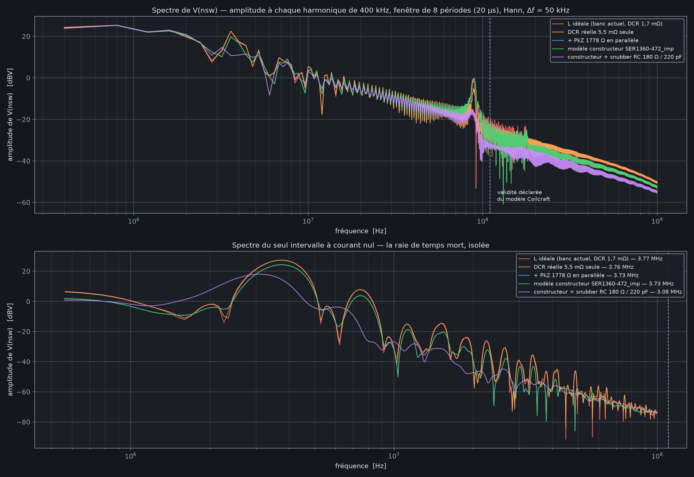
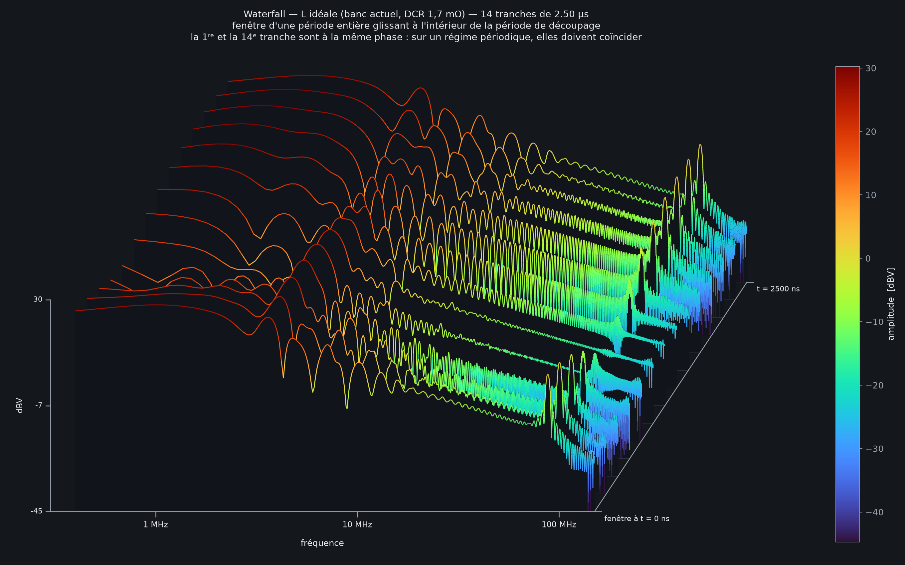

# EMI conduite — plan d'étude

Chapitre 4. Entrée : une architecture arrêtée au chapitre 3 et une
sélection de composants. Sortie visée : un spectre d'émission conduite
confronté à un gabarit, et un filtre d'entrée dimensionné.

**C'est la priorité n°1 du projet**, et c'est le poste le moins instruit :
les trois chapitres précédents n'ont produit aucune mesure spectrale.

## 0. Point de départ

| | |
|---|---|
| architecture | **DCM**, 400 kHz, 12–25 V → 80 V, 5–50 W |
| transistor | GaN EPC2207, modèle constructeur |
| diode | Vishay V8PA22 200 V / 8 A, modèle constructeur |
| inductance | Coilcraft SER2013-472, 4,7 µH, modèle à éléments localisés doc 267 |
| rendement établi | 97,06 % à 47,4 W, bouclage 1,7 % |

Outillage existant : `02-mosfet-diode/run_emi_conducted.py` — LISN simplifié
plus FFT numpy, écrit pour une configuration **périmée** (NVD6824NL,
200 kHz, 47 µH, 40 W). La mécanique est réutilisable, les composants non.

## 1. Décision à prendre d'abord : quel gabarit

Rien ne peut être conclu sans cette réponse, et elle n'appartient pas au
simulateur.

| gabarit | domaine | bande | LISN |
|---|---|---|---|
| CISPR 25 | automobile / embarqué | 150 kHz – 108 MHz | 5 µH |
| CISPR 32 (ex-22) classe B | résidentiel, ITE | 150 kHz – 30 MHz | 50 µH |
| CISPR 11 | industriel, scientifique, médical | 150 kHz – 30 MHz | 50 µH |

Le script existant compare à un CISPR 22/32 classe B « le plus souvent
cité en illustration », avec la réserve explicite que ce n'est pas
forcément le standard applicable. **Cette réserve doit être levée avant
de dimensionner quoi que ce soit** : la bande haute change d'un facteur
3,6 entre les deux familles, et l'impédance du LISN d'un facteur 10 — ce
qui déplace le filtre.

## 2. Deux problèmes distincts, à ne pas mélanger

C'est la structure de tout le chapitre.

### Mode différentiel

**Source** : l'ondulation du courant d'entrée. C'est la faiblesse connue
et acceptée du DCM — facteur 18 sur l'ondulation par rapport au CCM, et
un rapport crête/moyen de 10,8 en sortie contre 4,5. Le convertisseur
tire des impulsions triangulaires de 0 à 6,3 A.

**Chemin** : la boucle d'alimentation, aller et retour.

**Traitement** : condensateur d'entrée puis cellule LC différentielle.
Dimensionnable, et c'est précisément le pari posé au chapitre 3 — *« on
troque un problème filtrable contre un problème qui ne l'est pas »*. Ce
chapitre doit vérifier ce pari, ou l'infirmer.

### Mode commun

**Source** : le dv/dt du nœud de commutation contre le plan de masse et
le châssis. 80 V en quelques nanosecondes sur une capacité parasite.

**Chemin** : la capacité parasite du nœud chaud vers le châssis — y
compris celle du dissipateur s'il y en a un. **C'est une grandeur de
tracé, pas de catalogue**, et elle n'est connue que par extraction ou
mesure.

**Traitement** : condensateurs Y, self de mode commun, et surtout le
tracé lui-même.

> Le mode commun est le plus souvent le mode dominant et le moins bien
> prédit. Aucun des modèles actuels ne le porte : le circuit simulé n'a
> pas de châssis.

## 3. Ce qui manque au modèle, par ordre d'importance

**1. L'inductance doit passer au sous-circuit constructeur. — FAIT.**
L'étape A a été exécutée par anticipation ; le résultat complet est au
[§10 du chapitre 3](../03-architectures/inductances.md), les figures sont
reprises ci-dessous.

Attention au choix du modèle : Coilcraft en publie **deux** par référence,
et le dit dans l'en-tête de chaque bloc — `_freq` pour le domaine
fréquentiel (pertes en $\sqrt{f}$ par sources `LAPLACE`) et `_imp` pour le
**domaine temporel** (R/L/C pur, amortissement porté par une unique
résistance `PkZ` en parallèle). Prendre le premier pour un transitoire est
une faute silencieuse.

| modèle d'inductance, 4,7 µH | τ | **Q** |
|---|---|---|
| L + DCR 1,7 mΩ *(modèle initial)* | 558 µs | **6 567** |
| L + DCR **réelle** 5,5 mΩ, ×3 | 172 µs | **2 030** |
| sous-circuit constructeur `_imp` | **1,32 µs** | **16** |

**Facteur 400 mesuré**, et non les 20 000 estimés de tête : le GaN et la
diode dissipent aussi. Tripler la résistance **série** ne change rien — tout
tient à la résistance **parallèle**. Les résonances sont à **3,73 MHz**
(temps mort) et **89,1 MHz** (maille) : la première tombe en plein dans la
bande mesurée.

### Ce que l'amortissement change sur le spectre

En haut, l'amplitude à **chaque harmonique de 400 kHz** : pour un signal
périodique c'est le seul contenu réel, et tracer tous les bins noircit la
figure — à 50 kHz de résolution, sept bins sur huit ne portent que la fuite
de fenêtre, à −150 dB. En bas, le spectre du **seul intervalle à courant
nul**, où la raie de temps mort est isolée : l'amortissement la baisse de
3 dB et rabote ses harmoniques de 5 à 10 dB.

Où vit chaque raie dans la période : la ligne à 89 MHz à l'instant de la
coupure, et la bande à 3,7 MHz qui occupe tout le temps mort. Avec le
modèle constructeur elle **pâlit** avant l'allumage suivant ; sans lui elle
reste franche jusqu'au bout. Fenêtre de 410 ns, Δf = 2,4 MHz — la fréquence
exacte se lit sur la figure précédente, pas ici.

Quatorze tranches d'**une période entière chacune**, glissant de 192 ns à
l'intérieur de la période de découpage — en deçà d'une période, le
fondamental ne serait plus résolu. Le glissement total vaut exactement une
période : la 1ʳᵉ et la 14ᵉ tranche sont à la même phase et **doivent
coïncider**, contrôle de cohérence porté par la figure elle-même. Avec le
modèle constructeur, les creux entre 3 et 10 MHz sont nettement moins
profonds et la bande au-delà de 70 MHz est plus lisse.

> **Ce qui reste à faire sur ce point** : porter le modèle `_imp` dans le
> banc de pertes du chapitre 2, qui tourne encore en éléments discrets. À
> rapport cyclique identique, l'écart sur la puissance de sortie est de
> **9 %** — l'artefact ne faussait pas que l'allure des courbes.

**2. Les condensateurs doivent porter leur ESR et leur ESL.** Un MLCC de
10 µF X7R devient **inductif** au-dessus de quelques MHz : il cesse de
filtrer exactement là où on en a besoin. Un condensateur idéal dans une
simulation EMI donne un résultat faux dans le sens optimiste. Source :
courbes d'impédance ou paramètres S des fabricants.

**3. Le partage de l'inductance de maille entre les deux branches.**
Réserve ouverte depuis le chapitre 3 et jamais levée : tout a été simulé
avec la totalité de l'inductance dans la branche diode, ce qui est un
majorant pour la diode. Elle conditionne les tensions de résonance, donc
le contenu haute fréquence.

**4. La capacité parasite vers le châssis.** Sans elle, pas de mode
commun du tout. À estimer par le tracé, ou à balayer en paramètre pour
en connaître la sensibilité.

**5. Le LISN.** Modèle normalisé, immédiat, mais il faut choisir le bon
(§1).

## 4. Exigences numériques — non négociables

La FFT impose des contraintes que le reste de l'étude n'avait pas.

- **Pas de temps uniforme et imposé.** Une FFT sur un échantillonnage
  non uniforme n'a pas de sens. Le 4ᵉ champ du `.tran` fixe le pas
  maximum ; il faut aussi vérifier le pas *moyen* réel.
- **Fréquence maximale** : $\Delta t < 1/(2 f_{max})$, soit 4,6 ns pour
  108 MHz. Avec de la marge : **0,5 à 1 ns**.
- **Résolution fréquentielle** : $\Delta f = 1/T$. Pour séparer les raies
  à 400 kHz et descendre proprement à 150 kHz, viser $T \ge 200\ \mu$s,
  soit **80 périodes de découpage**. À 0,5 ns cela fait 400 000 points —
  faisable.
- **Nombre entier de périodes** dans la fenêtre, et fenêtrage explicite
  (Hann) : sinon les fuites spectrales créent des raies qui n'existent
  pas.
- **`.options plotwinsize=0`** obligatoire — la compression de courbes
  détruit le contenu haute fréquence.
- **Régime établi vérifié** avant la fenêtre de FFT, pas supposé.
- **Plancher de FFT** à comparer au gabarit : si le plancher numérique
  est au niveau de la limite, la simulation ne dit rien.

## 5. Déroulement, un changement à la fois

Discipline du dépôt : modèle simple d'abord, un raffinement à la fois,
balayage exhaustif en dernier.

| étape | ce qu'elle produit | critère de passage |
|---|---|---|
| ~~**A**~~ | ~~banc reconstruit avec le sous-circuit d'inductance~~ — **fait**, §3 point 1 | Q mesuré à **16**, τ = 1,32 µs < temps mort ✓ |
| **B** | LISN ajouté, aucun filtre | spectre brut, DM seul |
| **C** | condensateurs réels (ESR/ESL) | déplacement du spectre quantifié |
| **D** | séparation DM / CM | deux spectres, capacité châssis balayée |
| **E** | confrontation au gabarit | marge ou dépassement, en dB, par bande |
| **F** | filtre dimensionné puis vérifié | marge visée tenue, coût en pertes chiffré |
| **G** | réouverture du CCM | comparaison des deux architectures **sur le spectre** |

L'étape G est la réserve inscrite au chapitre 3 : l'hypothèse CCM a été
fermée sur un raisonnement, pas sur une mesure. Son avantage d'ondulation
— facteur 18 — n'a jamais été confronté au coût de son avalanche de
diode. C'est ici que ça se tranche.

## 6. Modèles constructeur utiles — et un faux ami

> **« Spectre » n'est pas un spectre.** Spectre est le nom du simulateur
> de Cadence, concurrent de SPICE. Un « modèle Spectre » est une netlist
> en syntaxe `.scs` : le même composant, une autre grammaire. Aucun
> rapport avec une émission. En général convertible, ou redondant avec la
> version SPICE déjà fournie.

Ce qui sert réellement :

| ressource | pour quoi | état |
|---|---|---|
| modèle d'inductance **temporel** (`_imp`, R/L/C + `PkZ`) | amortissement et résonance propre en transitoire | **acquis** pour SER1360-472 |
| modèle d'inductance **fréquentiel** (`_freq`, pertes en $\sqrt{f}$) | réponse en fréquence uniquement — *pas* pour un transitoire | acquis, non utilisé |
| paramètres S / Touchstone `.s2p` | condensateurs, selles de mode commun, filtres | à récupérer |
| courbes d'impédance (SimSurfing, REDEXPERT) | ESR/ESL des MLCC en fonction de la fréquence | à récupérer |
| modules EMI des calculateurs constructeur | pré-dimensionnement du filtre | disponible chez Würth |

Manques identifiés : **aucun modèle publié pour la famille SER2900**, ni
**pour la SER2013-472** — cette famille s'arrête à 2,0 µH. Le seul 4,7 µH
de la gamme SER modélisé est la **SER1360-472**, utilisée comme substitut
documenté pour la question de l'amortissement. Le choix de composant du
chapitre 3 reste à revoir sur ce point (§10 du chapitre 3).

## 7. Ce que ce chapitre ne fera pas

- **Aucune conformité.** Une simulation de spectre conduite donne un
  ordre de grandeur et des tendances comparatives, pas un procès-verbal.
  Les écarts entre simulation et mesure en EMI se comptent couramment en
  dizaines de dB, dominés par des parasites de tracé qu'aucun modèle de
  composant ne porte.
- **Aucun rayonné.** Hors de portée d'un simulateur de circuit.
- **Le raffinement des oscillogrammes** au-delà de ce qu'exige le
  spectre. Le constat posé au chapitre 3 — trois phases dont une mal
  amortie — est traité par l'étape A et pas davantage pour l'instant.
