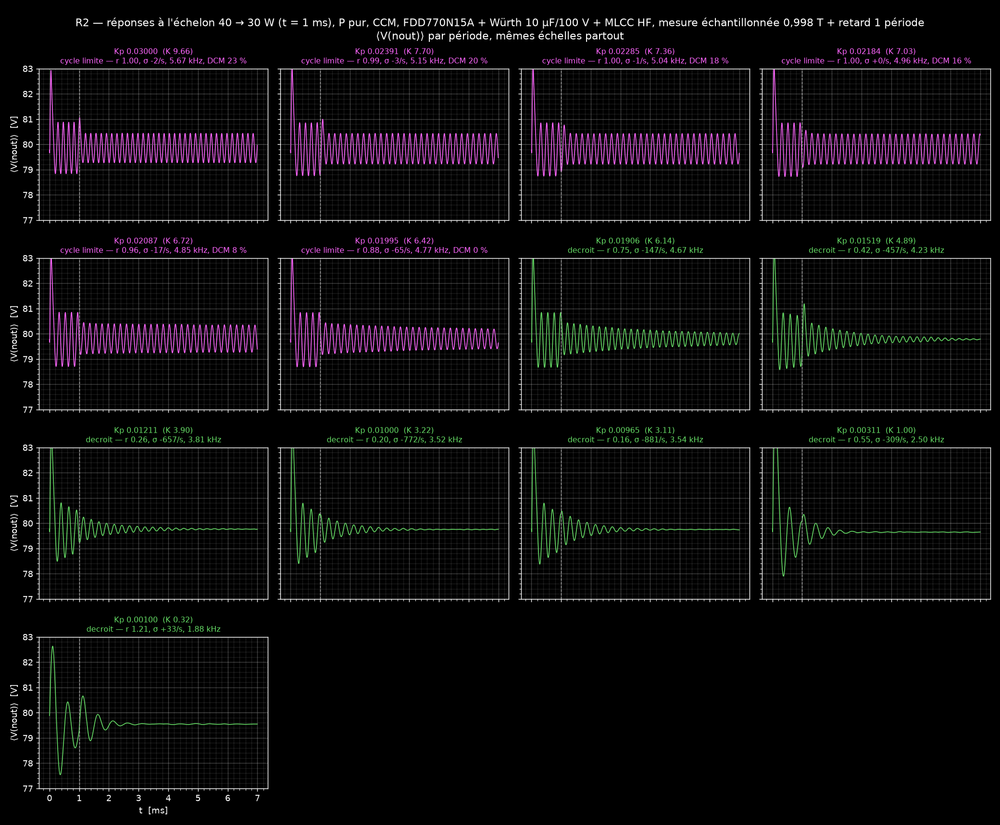
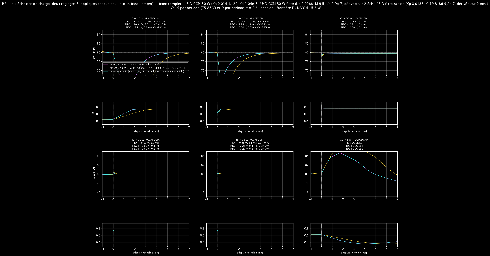
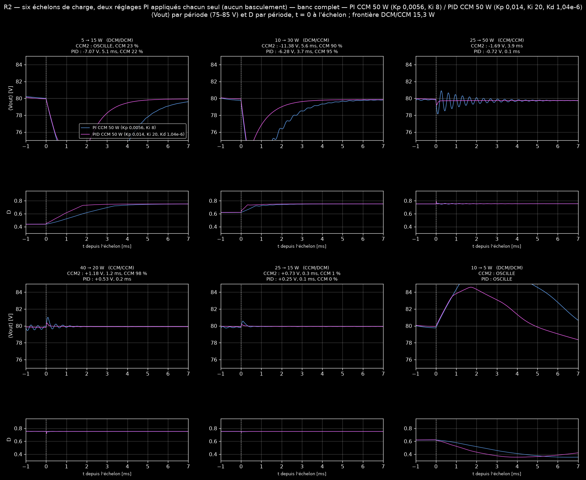

# 5 — Régulation

Plan d'ensemble et ordre des étapes : [plan.md](plan.md). Banc de
simulation et prémisses : [banc_r2.toml](banc_r2.toml).

## Conditions

**Point de fonctionnement**

| | |
|---|---|
| tension d'entrée Vin | **20 V** (plage réelle du montage : 12 à 25 V) |
| tension de sortie Vout | **80 V**, consigne régulée |
| fréquence de découpage fsw | **200 kHz** (période T = 5 µs) |
| puissance | **5 à 50 W** sur charge résistive (1280 à 128 Ω) ; frontière DCM/CCM ≈ 15 W sous 20 V |
| rapport cyclique D | 0,44 (5 W) et 0,62 (10 W) en DCM ; ≈ 0,75 en CCM |

**Composants** (modèles constructeur sauf mention)

| fonction | composant |
|---|---|
| inductance | Coilcraft **SER2211-473**, 47 µH (modèle Model1D publié) |
| interrupteur | onsemi **FDD770N15A**, 150 V, DPAK, grille 10 V par 10 Ω (l'Infineon IPD530N15N3 du montage se bloquait dans le solveur) |
| diode | Vishay **V8PA22**, Schottky 200 V / 8 A |
| condensateur de sortie | Würth **860130874006** (WCAP-ATET), **10 µF / 100 V**, ESR 0,37 Ω, ESL 5,6 nH (bibliothèque Würth) |
| découplage HF de sortie | MLCC 1 µF X7R 200 V 1812 en série avec 0,2 Ω (réseau de la fiche du montage) |
| maille de routage | 10 nH (valeur posée, comme au chapitre 4) |

**Chaîne de commande** (modèle du C2000 F28P551)

| | |
|---|---|
| mesure de Vout | filtre RC 1 µs (entrée ADC) |
| échantillonnage | une fois par période, à 0,998 T : fin de la fenêtre S+H juste avant la fermeture du MOSFET (datasheet F28P551, tableau 6-20) |
| retard | une période : l'échantillon de fin de période n commande la période n+2 (conversion, calcul, rechargement du registre de comparaison) |
| modulateur | dent de scie comparée à la commande, D borné à 0,05-0,95 ; anti-windup de l'intégrale |

**Échelons de charge simulés** (consigne fixe, charge commutée)

| essai | échelons |
|---|---|
| k-section du P | 40 → 30 W (CCM) ; 40 → 50 W (CCM, pire point) ; 5 → 10 W (DCM) |
| validation des réglages | croissants 5 → 15, 10 → 30, 25 → 50 W ; décroissants 40 → 20, 25 → 15, 10 → 5 W |

> Ce banc sert à **valider la méthode** : la sortie de 10 µF a été
> choisie pour des simulations courtes. Le montage final a une sortie
> de 130 µF (Nichicon), voir la portée en fin de page.

## Réglage par Ziegler-Nichols en boucle fermée

La méthode de Ziegler-Nichols en boucle fermée part d'un correcteur
**proportionnel pur**. On augmente Kp jusqu'à ce que la sortie oscille
avec une **enveloppe constante**, ni amortie ni divergente. Ce gain est
le gain ultime Ku, et la période de cette oscillation la période ultime
Tu. Les tables de Ziegler-Nichols en tirent les réglages, par exemple
pour un PI :

$$\Large K_p = 0{,}45\,K_u \qquad T_i = \frac{T_u}{1{,}2} \qquad K_i = \frac{K_p}{T_i}$$

Nous l'avons appliquée sur un **banc de validation de méthode** : la
sortie est un Würth 10 µF/100 V doublé du MLCC de découplage, et non
les 130 µF du montage final. L'interrupteur est le FDD770N15A. La
mesure de Vout est filtrée (RC de 1 µs), échantillonnée **une fois par
période** à la fin de la fenêtre S+H du F28P551 juste avant la
fermeture du MOSFET, et appliquée avec **une période de retard**, comme
le fera le C2000. Plutôt que de monter Kp pas à pas, chaque recherche
est une **k-section** : 4 valeurs de Kp lancées en parallèle par tour,
en partant des fortes valeurs, et l'intervalle se resserre jusqu'à 10 %
près en trois tours. Une simulation est jugée sur l'enveloppe de
l'oscillation de Vout qui suit un échelon de charge, et Tu se lit sur
une FFT.

Chaque limite a été **recoupée par une seconde méthode**. On injecte en
boucle ouverte une somme de sinusoïdes sur D (multi-tons) pour mesurer
directement le plant aux fréquences critiques, puis on calcule où la
boucle atteint −180°. En CCM, les deux méthodes concordent à 5 % sur
Ku et à 3 % sur la fréquence.

| point | Ku | Tu | méthode de recoupement |
|---|---|---|---|
| CCM, échelon 40 → 30 W | **0,0207 ± 3 %** | **0,21 ms** (4,8 kHz) | 0,0196 à 4,71 kHz |
| CCM, échelon 40 → 50 W (pire point) | **0,0135 ± 10 %** | **0,25 ms** (4,0 kHz) | 0,0152 à 4,28 kHz |
| DCM, échelon 5 → 10 W | **1,35 à 1,55** | **≈ 33 µs** (≈ 31 kHz) | 1,55 à 31,6 kHz |

*k-section du P en CCM : un panneau par Kp, du plus fort (cycle limite
d'environ 1,2 V, borné par des passages en DCM) au plus faible
(réponse amortie). La limite se situe entre Kp = 0,020 (décroissance
lente) et 0,021 (enveloppe constante), à 4,8-4,9 kHz.*

**Les coefficients de la table ne conviennent pas à ce plant.** Le PI
de Ziegler-Nichols (Kp 0,0093, Ki 57) **oscille** : cycle limite de
2,3 V à 3,6 kHz. La méthode suppose un plant amorti du type « premier
ordre avec retard ». Ici le plant CCM est un second ordre résonant
avec un zéro à partie réelle positive : avec Ki = 57, l'intégrale seule
place un croisement au pied de la résonance. Mesurée par la même
k-section, la limite de Ki vaut environ 30 à 30 W, et seulement 18 à 22
à 50 W. Ziegler-Nichols a donc servi à **mesurer** Ku et Tu, et les
réglages finaux ont été recherchés autour de ces mesures :

| réglage | Kp | Ki (V⁻¹·s⁻¹) | Kd (V⁻¹·s) | marges |
|---|---|---|---|---|
| PI CCM, réglé au pire point (50 W) | 0,0056 | 8 | — | croisement 2,9 kHz, MP 9°, MG 4,7 dB |
| PID CCM à dérivée simple (abandonné) | 0,014 | 20 | 1,04·10⁻⁶ | croisement 7,6 kHz, MP 52°, MG 4,8 dB à fsw/2 |
| **PID CCM**, dérivée filtrée, calculé sur le plant mesuré à 50 W | **0,0138** | **19,8** | **9,2·10⁻⁷** | croisement **6,9 kHz**, **MP 46°**, **MG 6,8 dB** (34,6 dB à fsw/2), min \|1+L\| 0,50 |
| PI DCM (0,45·Ku DCM) | 0,61 | 785 | — | — |

Aucun PI seul ne tient à la fois 6 dB de marge de gain et 45° de marge
de phase sur ce plant : il faut une dérivée. Elle est **discrète**,
comme dans le firmware, et sa forme compte. Le plant a été mesuré
jusqu'à 97,5 kHz, juste sous fsw/2 : |H| y reste plat. La dérivée
simple (Kd/T)·(e[n] − e[n−1]) a son gain maximal à fsw/2, où la marge
tombe à 4,8 dB, et fait alterner D d'une période à l'autre. La dérivée
sur deux échantillons a un gain nul à fsw/2 :

$$\Large D[n] = \ldots + \frac{K_d}{2T}\,\big(e[n] - e[n-2]\big)$$

Avec elle, la marge de gain minimale est de 6,8 dB sur toute la bande
mesurée, fsw/2 comprise.

*Six échelons, croissants en haut et décroissants en bas, avec les trois
PID CCM : dérivée simple, dérivée filtrée à Kp 0,0066, et dérivée filtrée
à Kp 0,0138, le réglage adopté. Celui-ci reprend la vitesse du PID
simple (25 → 50 W : −0,80 V et retour en 0,13 ms ; 40 → 20 W : +0,59 V
en 0,16 ms) et divise par 4 à 5 l'alternance de D d'une période à
l'autre. Abaisser Kp à 0,0066 gagnait 9° de marge de phase mais
triplait les temps de retour. Partant du DCM, les trois restent
lents.*

## Le problème DCM/CCM

Le convertisseur change de **mode de conduction** avec la charge. La
frontière vaut :

$$\Large P_{lim} = \eta\,\frac{V_{in}^2\,(1 - V_{in}/V_{out})}{2\,L\,f_{sw}}$$

soit environ **15 W sous 20 V** avec 47 µH, 6,3 W sous 12 V et 22 W
sous 25 V. La plage d'emploi privilégiée, 5 à 10 W, est donc en DCM,
tandis que la pleine charge est en CCM. Ce ne sont pas deux réglages
d'une même machine, mais **deux plants différents**. En CCM, le plant
est un second ordre résonant avec zéro RHP, et il oscille en basse
fréquence (4-5 kHz). En DCM, c'est un premier ordre, et seule la boucle
échantillonnée décroche, vers fsw/6,5 avec le retard d'une période. Les
gains limites diffèrent d'un facteur **≈ 65**.

Il n'existe donc **pas de réglage unique à la fois stable et
performant**. Le PI DCM est instable dès que le convertisseur passe en
CCM. Les réglages CCM, PI ou PID, sont stables partout, mais très
lents en DCM. À marge égale sur sa propre limite, un PI réglé pour le
DCM chute de 0,29 V et revient en 0,9 ms sur l'échelon 5 → 10 W, là où
le PI réglé pour le CCM chute de 4,8 V et revient en 5,6 ms.

*Six échelons de charge, croissants en haut et décroissants en bas, avec
le PI CCM réglé à 50 W (bleu) et le PID CCM à dérivée simple (magenta). Vout est tracé
sur 75-85 V. Quand l'échelon reste en CCM, le PID divise l'excursion
par 2,2 à 2,3 et le temps de retour par 7 à 26 : sur 25 → 50 W, il
passe de −1,7 V en 3,9 ms à −0,7 V en 0,15 ms. Partant du DCM
(5 → 15 W, 10 → 30 W, 10 → 5 W), les deux restent lents, avec des
creux de 6 à 11 V : leurs gains, réglés pour le CCM, sont environ 100
fois trop faibles pour le DCM. Les mentions « OSCILLE » des titres
désignent ici des retours lents, pas des oscillations.*

La réponse est le **basculement de gains** (gain scheduling) inscrit
dans la fiche du montage : le jeu DCM en DCM, le jeu CCM en CCM. Sous Vin
fixé, le mode se lit sur le rapport cyclique D, que le C2000 calcule
déjà. En CCM, D reste près de 1 − Vin/Vout (0,75 sous 20 V) quelle que
soit la charge, alors qu'en DCM il est plus bas et suit la charge
(0,44 à 5 W, 0,62 à 10 W). Ce basculement **n'est pas encore
modélisé**, et la traversée de la frontière reste à simuler.

> **Portée.** Tous ces chiffres valent pour le banc de validation
> (10 µF Würth, FDD770N15A). Ils **ne se transfèrent pas** au montage
> final (130 µF Nichicon, f₀ ≈ 0,5 kHz au lieu de 1,8 kHz) : c'est la
> **méthode** qui se transfère. Réserves ouvertes : plant à mesurer à
> 20-40 W pour les marges du PID (établies à 50 W seulement), aucune
> k-section en boucle fermée sur le PID, basculement à modéliser.
