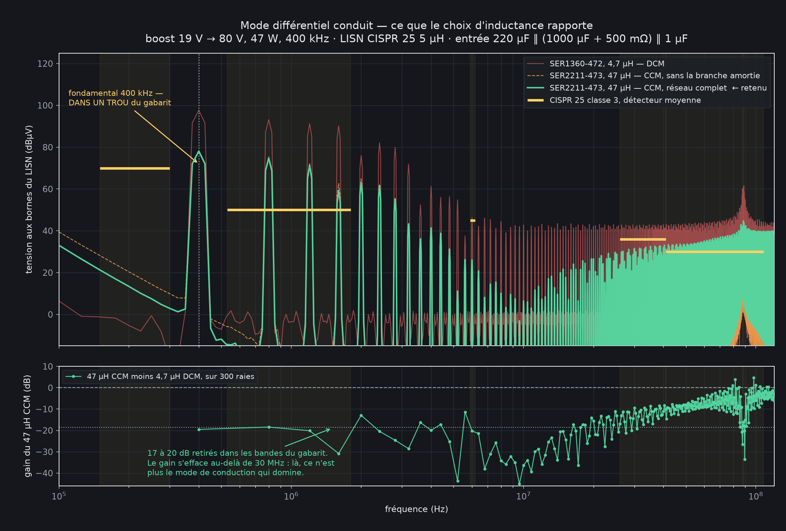
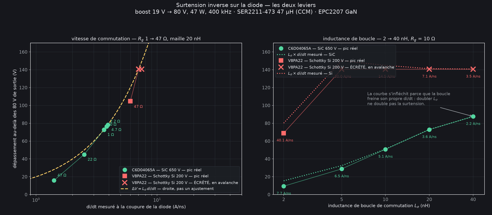

# LTSPICE-boost

Étude méthodique d'un étage boost (convertisseur élévateur de tension)
par simulation LTspice pilotée en Python, organisée en chapitres qui
ajoutent une dimension de réalisme à la fois — plutôt que de partir
directement sur un modèle complet "composants réels".

**Dépôt vivant, pas un dump final** : les chapitres sont publiés au fur
et à mesure, pas tous d'un coup. Les scripts génèrent le schéma LTspice
en texte brut (`.asc`), lancent la simulation en mode batch, parsent les
résultats `.meas`, et tracent les graphiques — tout est reproductible
depuis les scripts, aucun résultat n'est recopié à la main.

Le passage de **4,7 µH en conduction discontinue** à **47 µH en conduction
continue** retire **17 à 20 dB** sur tout le peigne d'harmoniques, sans
ajouter un seul composant au filtre — le courant d'entrée ne retombe plus à
zéro à chaque cycle.

<b>Paramètres de simulation</b> — <code>04-emi/run_cin.py</code>

| | |
|---|---|
| étage | boost 19 V → 80 V, 47 W, 400 kHz |
| inductances comparées | `SER1360-472` 4,7 µH (DCM) · `SER2211-473` 47 µH (CCM) — modèles Coilcraft |
| transistor | `EPC2207` GaN, modèle EPC |
| diode | `V8PA22` Schottky Si 200 V, modèle Vishay |
| réseau d'entrée | 220 µF ∥ (1000 µF + 500 mΩ) ∥ 1 µF X7R |
| réseau stabilisateur | LISN CISPR 25, 5 µH, mesure en tension |
| **$R_g$ / front de commande** | **1 Ω / 150 ps → 385 V/ns** ⚠ |
| fenêtre | 24 périodes d'établissement + 16 de mesure, pas max 0,5 ns |
| amortissement inductance | `PkZ` constructeur, non balayé |

> ⚠ **$R_g = 1\ \Omega$ et 150 ps, c'est l'extrême physique d'un GaN** —
> une valeur héritée du banc, jamais choisie. À 10 Ω on tombe à 73 V/ns,
> cinq fois moins. **Tout le contenu haute fréquence de ce spectre est donc
> à reprendre**, en particulier le pic vers 88 MHz. Les bandes basses, qui
> dépendent du mode de conduction et non de la vitesse, ne sont pas
> affectées.

### Les deux leviers de la surtension sur la diode

*Versions détaillées, une par levier :*
[vitesse de commutation](04-emi/illustrations/surtension_vs_vitesse.png) ·
[inductance de boucle](04-emi/illustrations/surtension_vs_maille.png)

$$\Large \Delta V = L_\sigma \frac{di}{dt}$$

**C'est la figure où la méthode annoncée plus bas se vérifie elle-même.** La
courbe pointillée n'est pas un ajustement : c'est le produit de deux
grandeurs mesurées indépendamment, $L_\sigma$ imposée et $di/dt$ relevé à la
coupure. Elle tombe sur les points, **sans aucun paramètre libre** :

| $L_\sigma$ | $di/dt$ mesuré | $L_\sigma \cdot di/dt$ | mesuré |
|---|---|---|---|
| 10 nH | 5,10 A/ns | 51,0 V | **50,8 V** |
| 20 nH | 3,65 A/ns | 72,9 V | **72,9 V** |
| 40 nH | 2,19 A/ns | 87,6 V | **87,6 V** |

Une loi du manuel, deux modèles constructeur, et le recoupement qui tient à
0,4 % près. C'est ce que vaut la **vérification croisée** revendiquée plus
bas — pas une intention de méthode, un résultat.

Deux faits que seule la comparaison des deux diodes fait apparaître. **De 1
à 22 Ω, la résistance de grille ne change rien** sur la Schottky silicium :
le $di/dt$ de la coupure est celui du recouvrement de la diode, pas de la
commande. Et **à boucle serrée elle coupe cinq fois plus vite** que la SiC —
40,1 contre 7,7 A/ns à 2 nH — ce qui explique que resserrer le routage ne la
sauve pas. Elle est en avalanche dans 9 cas sur 11 ; la SiC dans aucun.

<b>Paramètres de simulation</b> — <code>04-emi/run_surtension.py</code>

| | |
|---|---|
| étage | boost 19 V → 80 V, 47 W, 400 kHz |
| inductance | `SER2211-473` 47 µH, modèle Coilcraft — CCM dès 7,1 W |
| transistor | `EPC2207` GaN, modèle EPC |
| diodes comparées | `C6D04065A` SiC 650 V (Wolfspeed) · `V8PA22` Schottky Si 200 V (Vishay) |
| réseau d'entrée | 220 µF ∥ (1000 µF + 500 mΩ) ∥ 1 µF X7R |
| réseau stabilisateur | LISN CISPR 25, 5 µH |
| balayage 1 | $R_g$ = 1 · 2,2 · 4,7 · 10 · 22 · 47 Ω, à $L_\sigma$ = 20 nH |
| balayage 2 | $L_\sigma$ = 2 · 5 · 10 · 20 · 40 nH, à $R_g$ = 10 Ω |
| fenêtre | 8 périodes d'établissement + 2 de mesure, pas max 0,5 ns |
| grandeur portée | $di/dt$ **mesuré** à la coupure, pas le réglage de $R_g$ |

> Les croix ne sont pas des mesures de pic : la `V8PA22` est **écrêtée à
> 220,6 V** par son claquage, et c'est la puissance d'avalanche — jusqu'à
> 720 mW — qui dit ce qui a été dissipé pour l'obtenir.
>
> La fenêtre de 10 périodes suffit ici parce qu'on mesure une **crête**. Un
> spectre en demande seize : ne pas réutiliser ce réglage pour de la CEM.

Deux choses que cette figure dit et qu'un gabarit continu masquerait :

- **le fondamental à 400 kHz ne tombe dans aucune bande.** CISPR 25 vise
  des bandes de service radio, séparées par des trous — ici 0,3 à
  0,53 MHz. Ce qui contraint, ce sont H2 à H4 en moyennes ondes ;
- **au-delà de 30 MHz le gain s'efface.** Là, ce n'est plus le mode de
  conduction qui domine mais la résonance de la maille de commutation, et
  aucun choix d'inductance d'entrée ne l'atteint.

> L'ESR et l'ESL des deux électrolytiques sont **posées, non relevées** :
> les références Panasonic exactes ne sont pas encore fixées. L'ESR du
> 220 µF commande la marge de stabilité du filtre, de −3,4 dB (polymère à
> 2 mΩ, instable sans la branche amortie) à +28,9 dB (100 mΩ). À remplacer
> dès que la référence est connue.

## Pourquoi ce dépôt

Montrer la démarche, pas seulement le résultat : hypothèses de départ
confrontées au calcul puis à la simulation, bugs trouvés et corrigés en
cours de route (voir chapitre 1 §3 — une erreur de constante de temps
qui donnait des rendements supérieurs à 100%), vérification croisée
systématique entre formule analytique et SPICE plutôt que la confiance
aveugle dans l'un ou l'autre.

## Chapitres

| # | Sujet | État |
|---|---|---|
| 1 | [Fréquence de découpage et choix d'inductance](01-frequence-inductance/) | ✅ fait |
| 2 | [Technologie switch/diode (Si vs GaN, Schottky vs ultrafast)](02-mosfet-diode/) | ✅ fait |
| 2b | [… étendu 200-800 kHz : calibre vs technologie](02-mosfet-diode/#11-extension-200-800-khz--le-calibre-avant-la-technologie) | ✅ fait |
| 3 | [Architectures (CCM/DCM) et inductance](03-architectures/) | ✅ fait |
| 4 | [EMI conduite](04-emi/) | 🚧 en cours (gabarit CISPR 25 obtenu, premiers spectres, architecture tranchée) |

## Méthode générale

- **Composants idéaux d'abord**, puis une seule dimension de réalisme
  ajoutée par chapitre (switch/diode idéaux + inductance réelle au
  chapitre 1, puis switch/diode réels au chapitre 2, etc.) — jamais un
  modèle entièrement réaliste dès le départ.
- **Vérification croisée** : chaque conclusion de simulation est
  recoupée avec une formule analytique connue (ici, le seuil CCM/DCM
  d'un boost, Erickson *Fundamentals of Power Electronics*) avant
  d'être retenue.
- **Les bugs de méthode sont documentés, pas effacés** : voir chapitre 1
  §3 pour un exemple (constante de temps de sortie bien plus longue que
  la fenêtre de simulation, donnant des rendements physiquement
  impossibles avant correction).

## Outils

LTspice (mode batch, ligne de commande), Python (génération de schéma,
pilotage des balayages, parsing des résultats, graphiques matplotlib).
Aucune dépendance Python exotique — `matplotlib` seul suffit en dehors
de la bibliothèque standard.
